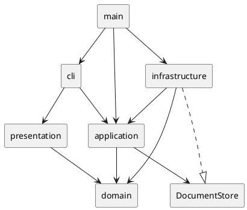
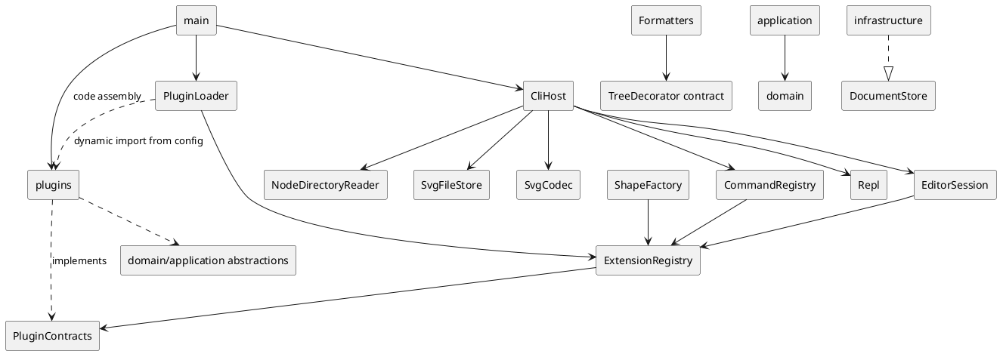
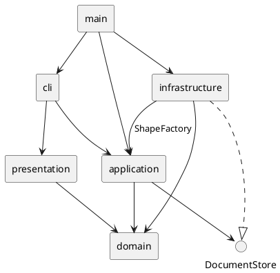

# SVG 编辑器架构与验收说明

本文说明当前工作区的 CLI、插件和 VS Code 扩展，并保留 Phase 1 的历史设计及验证记录。使用方式见 [项目说明](../README.md)。指标报告对应固定的 `final`、`p2` 标签；当前代码包含 `p2` 之后的修改，版本范围见“验收与指标”。

## Phase 2 当前架构

Phase 2 为 CLI 提供图形、命令、树标签和属性处理四个扩展点，并新增 VS Code 扩展。启动代码负责选择插件、创建对象并连接依赖。编辑逻辑通过接口和注册表调用插件，文件系统和 VS Code API 由各自的适配器访问。

### 模块和依赖

```text
src/
  main.ts                              # 启动入口：代码加载或配置加载插件
  assembly/PluginLoader.ts              # 配置校验、ESM 加载和插件安装
  assembly/CliHost.ts                   # 创建并连接会话、CLI 和适配器
  application/extensions/
    PluginContracts.ts                 # 扩展接口及清单，转出 TreeDecorator
    ExtensionRegistry.ts               # 暂存注册，校验通过后统一加入注册表
    StagingContext.ts                  # 保存当前插件的暂存注册项
    DuplicateRegistrationError.ts      # 重复注册错误
  application/BuiltinCommands.ts       # 内置命令名称，供分发和冲突检查共用
  application/DirectoryReader.ts        # dir 使用的目录访问端口
  application/DirectoryReadError.ts     # 目录访问错误及路径
  infrastructure/NodeDirectoryReader.ts # Node 文件系统适配器
  domain/TreeDecorator.ts               # 树标签接口，供应用和展示层共用
  domain/shape/DiamondShape.ts          # 菱形几何、属性和撤销所需的变更记录
  plugins/
    shapes/BuiltinShapeProvider.ts      # 内置图形共用的 SVG 读回流程
    shapes/RectShapeProvider.ts         # 矩形创建与读回
    shapes/GroupShapeProvider.ts        # 容器创建与读回
    shapes/CircleShapeProvider.ts       # 圆形创建与读回
    shapes/EllipseShapeProvider.ts      # 椭圆创建与读回
    shapes/LineShapeProvider.ts         # 直线创建与读回
    shapes/TextShapeProvider.ts         # 文本创建与读回
    shapes/DiamondShapeProvider.ts      # 菱形创建及 polygon 读写
    shapes/BuiltinShapesPlugin.ts       # 注册七种内置图形提供器
    stats/StatsPlugin.ts                # 注册 stats
    stats/StatsCommand.ts               # 统计叶子和容器
    dir/DirPlugin.ts                    # 注册 dir
    dir/DirCommand.ts                   # 目录排序、格式化和错误输出
    box/BoxShape.ts                     # box 结构及必要子部件保护
    box/BoxPlugin.ts                    # 注册图形、属性处理器和类型标签
    box/BoxShapeProvider.ts             # box 创建和 SVG 读写
    box/BoxAttributeHandler.ts          # fill 和 label 修改
    box/BoxTypeDecorator.ts             # (box) 标签
    tree/ModifiedStarPlugin.ts          # 注册星号标签
    tree/ModifiedStarDecorator.ts       # 比较保存状态并生成星号
vscode-extension/src/
  extension.ts                         # 向 VS Code 注册 provider
  SvgFileDecorationProvider.ts         # Explorer SVG 标记
  fileDecorationPolicy.ts              # 判断文件是否应显示标记
  SvgOutlineProvider.ts                # 原生大纲适配
  svgOutline.ts                        # XML 节点和源码范围
  SvgSourceRanges.ts                   # 扫描完整元素和开标签的源码边界
```

Phase 1 的主要依赖关系：



Phase 2 通过扩展接口调用插件，由启动层的 `PluginLoader` 解析模块路径并加载插件：



当前依赖规则如下；组合根指负责创建对象、选择实现和连接依赖的启动代码。

| 模块 | 允许依赖 | 原因 |
|---|---|---|
| domain | domain | 图形和文档规则可独立运行 |
| application | application、domain | 组织编辑、历史和扩展调用 |
| presentation | presentation、domain | 读取图形和树标签接口，生成文本 |
| cli | cli、application、presentation、Node 终端 API | 读取输入、分发命令、输出结果 |
| infrastructure | infrastructure、application、domain、外部库 | 实现文件和目录访问，处理 XML |
| plugins | 插件自身代码、application/domain 的公开接口和图形类 | 实现扩展功能；各插件可单独加载 |
| assembly | assembly、application、domain、cli、infrastructure、Node 模块加载 API | 创建宿主并按配置加载插件 |
| main.ts | 启动所需模块及默认插件 | 选择本次运行的插件集合 |

`test/architecture/Dependencies.test.ts` 检查静态 import 的层级方向和领域层的外部依赖，并检查工厂、命令注册表以外按图形类型名分支的写法。检查器按目录分类，尚未自动检查插件对具体类的访问是否属于公开 API，也未禁止插件之间互相导入；这些仍需人工审查。

生产代码中的类各自放在同名文件内；同一架构测试还检查 CLI 与 VS Code 扩展的类文件数量和命名，防止插件实现再次堆叠到入口文件。

### 两种插件加载方式

代码装配由 `src/main.ts` 调用 `PluginLoader.install(plugin, options)`。配置装配由 `PluginLoader.loadConfig(path)` 加载模块，读取清单后调用同一个 `install`。插件都在暂存注册表中运行 `activate`；清单、名称校验通过后，注册结果才加入正式注册表。

代码装配的最小示例：

```ts
import { ExtensionRegistry } from "./application/extensions/ExtensionRegistry.js";
import { PluginLoader } from "./assembly/PluginLoader.js";
import { createCliHost } from "./assembly/CliHost.js";
import builtinShapesPlugin from "./plugins/shapes/BuiltinShapesPlugin.js";
import boxPlugin from "./plugins/box/BoxPlugin.js";

const extensions = new ExtensionRegistry();
const loader = new PluginLoader(extensions);
for (const plugin of [builtinShapesPlugin, boxPlugin]) {
  const error = loader.install(plugin);
  if (error !== undefined) console.log(error);
}
createCliHost(extensions).start();
```

示例路径相对 `src/main.ts`。默认入口始终安装内置图形。可选插件优先取自 `--config <path>`，否则检查当前工作目录的 `plugins.config.json`。未传 `--config` 且默认文件不存在时，依次安装 stats、dir、modified-star 和 box。

将下面的配置保存为仓库根目录的 `plugins.config.json`，执行 `pnpm cli --config plugins.config.json`。省略 `--config` 也会自动读取该文件。

```json
{
  "plugins": [
    { "module": "./src/plugins/stats/StatsPlugin.ts" },
    { "module": "./src/plugins/dir/DirPlugin.ts" },
    { "module": "./src/plugins/tree/ModifiedStarPlugin.ts" },
    { "module": "./src/plugins/box/BoxPlugin.ts", "options": {} }
  ]
}
```

| 字段 | 规则 |
|---|---|
| `plugins` | 必填数组，按数组顺序加载；空数组关闭全部可选插件 |
| `module` | 必填的非空字符串，指向带默认导出的插件对象；相对路径以配置文件目录为准 |
| `enabled` | 可选布尔值，省略时加载；`false` 时完全跳过模块导入 |
| `options` | 可选任意 JSON 值，原样传给 `activate(context, options)`；现有四个可选插件均不使用它 |

包名使用加载器运行环境的 ESM 解析规则。上面的源码配置供 `pnpm cli` 使用；编译后的 `node dist/main.js` 应配置对应的 `dist/plugins/…/*.js` 路径。配置不可读或格式错误时，输出 `error: invalid plugin config`，只保留内置图形和命令，继续启动。

插件包的 `package.json` 使用 `contributes` 声明注册名。box 包的示例：

```json
{
  "name": "box",
  "type": "module",
  "main": "./BoxPlugin.ts",
  "contributes": {
    "shapes": ["box"],
    "commands": [],
    "attributes": ["box-attributes"],
    "decorators": ["box-type-label"]
  }
}
```

四类名称列表省略时按空列表处理。加载器要求声明的类别和名称与实际注册结果一致。同类名称重复、清单不匹配或激活失败时，丢弃当前插件的全部暂存注册，保留已安装插件并继续处理下一项。包元数据的读取条件见 ADR-4。

### 扩展点清单

| 接口 | 职责与内核调用位置 | 实现 | 禁用时的行为 | 违反契约时 |
|---|---|---|---|---|
| `ShapeProvider` | 创建及读回/写出图形；`src/application/ShapeFactory.ts` 的 `create/fromElement/toElement` | `BuiltinShapesPlugin` 注册七个提供器，`BoxPlugin` 注册 `BoxShapeProvider` | 关闭可选插件时七种内置图形仍可用；box 标记的 `<g>` 按普通组读回 | 同名或清单不一致时拒绝插件；同优先级多个读取器或多个写入器命中时报错 |
| `PluginCommand`（实验中的 `Command` 扩展点） | 命令分发与帮助；`src/cli/CommandRegistry.ts` 的 `execute/help` | `StatsPlugin`、`DirPlugin` | 未注册命令报 `error: unknown command: <name>` | 与已注册插件命令或内置命令同名时拒绝安装；参数错误由命令报告 usage |
| `TreeDecorator` | `src/presentation/Formatters.ts` 的 `tree/decoration` 调用 `prepare/decorate`；`src/application/EditorSession.ts` 的 `markDecoratorsSaved` 调用 `onSaved` | `ModifiedStarPlugin`、`BoxPlugin` | 无树标签插件时保留 Phase 1 树输出 | 同名注册拒绝安装；回调异常向上传递；宿主不隔离插件对文档的直接修改 |
| `AttributeHandler` | `src/application/EditorSession.ts` 的 `prepareAttributeChange` 选择处理器，`commands/SetAttributeCommand.ts` 的 `execute` 提交变更 | `BoxPlugin` 的 `box-attributes` | 无命中时使用图形原有属性白名单 | 多个命中时拒绝修改；`apply` 抛错后调用 `undo`，成功回滚时保留原文档和历史 |

内置图形各有一个 `ShapeProvider` 实现，提供器必须用 `usage` 给出创建语法，供 `help` 显示；新增 provider 后不再修改 CLI 的帮助表。`EditorSession.shapeCreationUsages` 从本会话的注册表读取语法，未初始化文档也能查询。已有外部 provider 接入此版本时需补充 `usage`。`BuiltinShapeProvider` 封装公共 SVG 属性处理和容器子节点装配。类型名到 provider 的解析由 `ShapeFactory` 和 `ExtensionRegistry` 完成。

加载失败的消息由 `src/assembly/PluginLoader.ts` 生成：

| 情况 | 输出 |
|---|---|
| 顶层模块不存在 | `error: plugin not found: <module>` |
| 没有默认导出 | `error: plugin has no default export: <module>` |
| 清单与注册内容不符 | `error: plugin manifest mismatch: <name> (declared: …, registered: …)` |
| activate 抛错 | `error: plugin failed to activate: <name> (<reason>)` |
| 同类名称重复 | `error: duplicate registration: <category>/<name>` |
| 模块或依赖求值失败 | `error: plugin failed to load: <module> (<reason>)` |

注册事务只保证暂存项可全部丢弃，无法撤销插件自行执行的文件写入等外部操作。插件应在 `activate` 中只注册功能。

### 插件命令与目录适配器

`PluginCommand` 提供 `name`、`usage`、`help` 和 `execute(args, context)`。命令名称和参数说明都写在对应插件中。`stats` 从画布子节点开始深度优先遍历，按类型首次出现的顺序统计叶子。普通组和 box 只计入容器数，box 内部图形照常计入叶子数。

`dir` 通过 `DirectoryReader` 的 `currentPath` 和 `list()` 访问目录。`CliHost` 创建 `NodeDirectoryReader` 并传给 `CommandRegistry`，命令执行时从上下文取得它。适配器在构造时记录 `process.cwd()`，调用 `readdirSync` 读取直接子项。

在 Adapter 模式中，`DirCommand` 是调用方，`DirectoryReader` 是目标接口，`NodeDirectoryReader` 是适配器，Node 文件系统 API 是被适配的服务。测试可用返回固定目录项的对象替换真实适配器。

命令按目录、文件、特殊项的顺序分组，各组按名称排序。符号链接等特殊项显示为 `[OTHER]`，不遍历目标。读取失败时输出 `error: cannot read directory: <path>`。`dir` 无需先创建 SVG 文档，也不修改文档或历史。

### 属性、box 与树标签决策

#### ADR-1：属性变更按一次命令准备和提交

宿主将目标 `Shape`、属性名和值传给处理器。`handles` 只判断是否支持这次操作。`BoxAttributeHandler` 通过 `instanceof BoxShape` 判断类型，再通过公开的 `rectangle`、`label` 访问内部部件，调用部件的 `prepareSet` 准备修改。

没有处理器命中时沿用图形白名单；一个命中时由该处理器负责；多个命中时直接报错。`prepare` 应完成校验并返回 `GeometryChange`，准备期间不得修改文档。若涉及多个子部件，应先全部准备，再返回一个能整体应用和撤销的变更对象。

`SetAttributeCommand.execute` 调用一次 `apply`，成功后才记录历史。若部分修改后抛错，就调用该变更的 `undo`；历史保持原样。处理器必须保证 `undo` 能还原已执行的部分，回滚也失败时宿主报告 `attribute change failed and rollback was incomplete`。相关测试见 `test/application/AttributeHandler.test.ts`。

#### ADR-2：已安装 box 的无效结构拒绝读入

`box` 保存为 `<g data-kind="box">`，必要子部件的 ID 为 `<id>-rect` 和 `<id>-label`。创建时校验整个新增子树的 ID，冲突则整条命令失败。加载 box 插件后，读入缺少必要部件、部件类型错误或 ID 重复的文件也会失败，原文档保留。

新建 box 的内部矩形使用实验模板的默认填充 `#4a90d9`；修改 fill 后撤销会恢复该颜色。读入已有 SVG 时保留文件中的样式，不补写创建时的默认颜色。

关闭 box 插件后，`GroupShapeProvider` 忽略 `data-kind`，保留子节点并将其读为普通组。启用插件时可以保证 box 包含类型正确的矩形和文本；关闭插件后仍能查看文件结构。

`BoxShape.canModifyChild` 保护两个必要部件。直接删除、移走、分组、移动、缩放或设置这些部件会报 `cannot modify required child: <id>`。应通过 box 整体移动、缩放，或通过其 `fill`、`label` 属性修改内容。附加的普通子节点仍可编辑。解散 box 会报 `cannot ungroup composite shape: <id>`。测试见 `test/plugins/BoxPlugin.test.ts`。

#### ADR-3：dirty 按内容相对保存点比较

`modified-star` 用 `*` 表示内容与最近一次成功的 `init/read/save` 不同。新建节点立即显示 `*`，其祖先和画布也会显示。撤销回保存时的内容后，星号消失。`canvas` 修改尺寸时保留原比较基准，尺寸与基准不同就会标星。状态保存在每个标签实例自己的字段中。

`tree` 查询时，标签插件遍历一次文档，比较各节点的属性和按顺序排列的子节点 ID、类型，再向祖先汇总变化。属性按键排序后比较，设置属性的先后顺序不算内容变化；子节点顺序影响绘制层级，仍计入变化。把已保存的图形移到另一容器且保持其内容不变时，该图形自身不标星，原父容器、新父容器及其祖先反映结构变化。

同一行的标签按注册顺序拼接。默认顺序为 `modified-star`、`box-type-label`，因此新建 box 显示为 `g#n1 * (box)`。保存后显示为 `g#n1 (box)`。标签前的 `g#n1` 由 `BoxShape.treeLabel` 提供。测试见 `test/plugins/ModifiedStarPlugin.test.ts`。

#### ADR-4：配置清单从插件包元数据校验

配置加载器先解析模块路径并导入默认插件对象，再向上寻找最近的 `package.json`。该文件有 `main` 或 `exports` 时，使用其中的名称和 `contributes` 校验注册结果；缺少入口字段或未找到包文件时，使用插件对象的 `manifest`。代码装配直接使用对象清单。

插件激活后，注册表检查声明与实际注册的类别、名称是否一致，再检查与已安装插件及内置命令是否重名，全部通过后才提交。内置命令名称集中于 `BuiltinCommands.ts`，CLI 分发表通过完整的 `Record<BuiltinCommandName, CommandHandler>` 保持对应。冲突插件的全部暂存注册均丢弃，后续插件继续加载。顶层模块不存在与模块、依赖求值失败分别报错。配置测试覆盖包清单覆盖对象声明、加载失败和注册回滚，见 `test/assembly/PluginLoader.test.ts` 和 `PluginConfigWorkflow.test.ts`。

### VS Code 扩展与 Phase 1 复用

`vscode-extension/src/extension.ts` 是扩展入口。VS Code 加载并调用 `activate(context)`；扩展把 `SvgFileDecorationProvider`、`DocumentSymbolProvider` 和文件创建/删除/重命名事件订阅加入 `context.subscriptions`，由 VS Code 在 Explorer 更新或 Outline 请求符号时调用。

文件标记通过 VS Code 的 provider 接口返回 `FileDecoration`。经典 Decorator 通过包装同接口对象、委托原对象调用来叠加行为。本实现由 VS Code 调用注册的 provider，再把返回的标记画到文件旁，采用平台回调扩展机制。

`SvgFileDecorationProvider` 调用 VS Code 文件 API 获取文件类型，并调用纯函数 `shouldDecorateSvg` 判断是否显示标记。`SvgOutlineProvider` 将本地解析结果转换成 `DocumentSymbol` 和 `Range`，完成编辑器 API 适配。两者都通过注册对象向平台提供功能。

扩展继续使用 `@xmldom/xmldom` 解析 XML，独立实现了保留源码位置的遍历。`SvgCodec` 会把支持范围内的 SVG 转换成可编辑图形树，无法直接提供大纲所需的源码范围。大纲还要处理暂时不完整的 XML，因此未复用 CLI 的解析器和领域模型。文件标记只需要文件 URI 和类型。

XML 校验通过后，`SvgSourceRanges` 扫描原始源码，区分注释、CDATA、处理指令和带引号的属性，记录开标签与对应闭标签的位置。`DocumentSymbol.range` 覆盖完整元素及子树，`selectionRange` 只覆盖开标签，点击大纲时定位到元素声明。测试覆盖嵌套同名元素、多行标签、LF/CRLF/CR 和编辑后的范围更新。

```sh
pnpm build:vscode
code --new-window "--extensionDevelopmentPath=$PWD/vscode-extension" "$PWD"
```

在仓库根目录安装依赖后运行上述命令；PowerShell 中可使用 `pnpm.cmd`。`$PWD` 展开为当前目录的绝对路径。开发宿主启动后，可用 `Developer: Show Running Extensions` 确认扩展已加载。

演示使用 [flowchart.svg](../examples/flowchart.svg)。在 Explorer 中展开 `examples` 查看文件标记，再用 `Text Editor` 打开 SVG。展开 Outline 中的分组并点击叶子节点，检查源码定位；修改元素 ID 后检查大纲更新，暂时删掉闭合标签后检查大纲清空。

[文件标记示例](../docs/images/vscode-svg-badge.jpg) 和 [大纲定位示例](../docs/images/vscode-svg-outline.jpg) 是实验附图的副本，仅说明目标界面。本项目扩展运行时的截图仍待补充。`test/vscode-extension` 验证文件筛选规则及解析函数的嵌套、无 ID、位置、文本更新和不完整 XML 行为；这些测试未启动 VS Code 宿主。

### 验收与指标

2026-11-26 文档修订开始时，对已提交代码 `af70730` 执行的检查如下。修订期间工作区另有源码重构，表内结果对应重构前的版本；后续源码修改应重新运行这些命令。

| 检查 | 结果 |
|---|---|
| `pnpm typecheck` | 业务代码类型检查通过 |
| `pnpm typecheck:test` | 测试代码类型检查通过 |
| `pnpm typecheck:vscode` | VS Code 扩展类型检查通过 |
| `pnpm test --test-reporter=tap` | 234 项通过，0 失败 |
| Phase 1 基础会话历史对照 | 在临时目录运行 `final` 与 `af70730` 无可选插件版本；两者及预期输出的 1069 字节完全一致 |

插件、目录适配器、属性回滚、box 结构、dirty 状态和配置加载的测试分别位于 `test/plugins`、`test/application`、`test/assembly`。VS Code 的验证范围见上一节。下方的 194 项测试结果只属于 Phase 1 历史记录。

2026-11-26 完成审查问题 1–7 的修复后，当前工作区的 242 项测试、业务/测试/VS Code 三组类型检查，以及 CLI/VS Code 两项构建均通过。新增回归覆盖类文件约束、内置命令重名及完整注册回滚、动态图形帮助、box 默认填充及树标签、dirty 属性顺序和子节点顺序，以及大纲的完整元素范围。大纲验证使用自动测试，未启动 VS Code 宿主进行界面复测。

#### 双装配运行验证

`test/assembly/PluginConfigWorkflow.test.ts` 分别运行代码装配入口 `test-support/CodeAssemblyCli.ts` 和配置入口 `src/main.ts --config`。每组创建内容相同的临时工作目录，保持插件集合、顺序和输入一致，逐字节比较两次输出及预期输出。

| 会话 | 插件集合 | 输入与预期 |
|---|---|---|
| Phase 1 基础会话 | 无可选插件 | `phase1-baseline.input.txt`、`phase1-baseline.stdout.json` |
| box 会话 | box | `phase1-box.input.txt`、`phase1-box.stdout.json` |
| stats、dir 会话 | stats、dir | `stats-dir.input.txt`、`stats-dir.stdout.json` |

输入文件位于 `test/fixtures/phase2/transcripts`，预期输出位于 `test/fixtures/phase2/expected`，初始 SVG 位于 `test/fixtures/phase2/files`。输出由测试进程捕获，不写入被 `dir` 列举的目录。单独运行：

```sh
pnpm exec tsx --test test/assembly/PluginConfigWorkflow.test.ts
```

这些测试用于验证两种装配下的行为一致。基础会话还与 `final` 做了上述历史对照；box 和新增命令使用对应预期输出，运行结果应结合被测代码版本检查。

#### 插件接入的提交证据

以下命令可核查 box 首次接入的变更。PowerShell 中保留引号：

```sh
git show --name-status --format=oneline a8b1f1f
git ls-tree --name-only "a8b1f1f^" src/
git diff "a8b1f1f^" a8b1f1f -- src ":(exclude)src/plugins/box/**"
```

`a8b1f1f` 只新增 box 的两个源码文件及一个测试文件；排除新插件目录后的 `src` 差异为空。不过该提交没有新增顶层装配或配置演示，当前历史尚未提供满足 lab §6 全部差异判据的独立 A/B 接入提交。

dir 的首次接入提交 `d41f319` 同时修改了 `DirectoryReader` 并新增 `NodeDirectoryReader`，因此该提交也不满足“接入插件时内核改动为零”的要求。双装配运行测试不能替代这些提交差异证明。

#### 指标对应的版本

`pnpm metrics` 按 [生成脚本](../scripts/phase2-metrics.mjs) 读取 Git 历史，生成 [指标报告](../docs/metrics/phase2.md)。报告包括文件清单、顶层类型和函数、内核/装配/插件三类行数，以及函数和文件的圈复杂度。

比较范围固定为 `final=41a3aa3` 与 `p2=a956757`。本次文档核对时，代码 HEAD 为 `af70730`，比 `p2` 多 7 次提交，包含树标签优化、双装配会话测试、图形提供器拆分和 diamond。现有指标描述两个标签之间的变化，不覆盖这些后续修改。

VS Code 扩展在报告中单独统计，测试、依赖和构建产物排除。现有 `p2` 标签未包含后续收尾工作，提交内容与标签范围仍需按实验要求确认；实验规定已打标签不得移动。

### Phase 2 过程记录

以下根据已有提交和测试整理，原始 AI 对话未随仓库保存。表中列出可从代码验证的问题与修正，供复查 AI 生成的方案和实现时参考。

| 问题 | 调整与依据 |
|---|---|
| 普通结构操作可能摘走复合图形的必要部件 | `e4d6f4b` 引入容器能力，`e0612ad` 在结构修改前检查受保护子节点，并补充失败不改变结构的测试 |
| box 读回需要保留子节点顺序并拒绝额外文本 | `7527f73` 调整读回过程，新增顺序和文本校验 |
| 仅依赖插件对象清单，无法检查包中声明是否一致 | `d453d10` 加入包清单校验；配置与代码装配共用注册流程 |
| dirty 查询重复构造整棵子树的内容记录 | `be25a08` 改为一次后序遍历，并补充插入、删除、撤销和保存状态的测试 |
| 两种装配缺少完整会话对照 | `65c0e7c` 提取共用宿主，新增三组输入、预期输出及进程测试 |
| 图形类型判断仍散落在提供器、统计和展示代码中 | `cb7058c` 拆分各图形提供器，增加容器能力和展示接口，并加入类型名分支检查 |
| 验证新增形状的接入方式 | `da043df` 增加 diamond 模型和提供器，并在内置插件中注册；格式和操作见 [diamond 说明](../docs/phase2-diamond.md) |

### Phase 2 一致性自查

模块目录与上面的当前架构一致。`TreeDecorator` 定义在 domain，应用接口文件将其转出，展示层直接依赖 domain。图形创建和 XML 读写由各 provider 实现，`ShapeFactory` 负责选择 provider。编辑历史仍使用 Command，分组和 box 复用 Composite 的递归操作。

新增图形时需要实现图形类和 provider，再选择代码或配置方式注册。新增命令可实现 `PluginCommand`；新增标签可实现 `TreeDecorator`；新增属性语义可实现 `AttributeHandler`。当前 diamond 放在内置图形插件中，始终启用，尚未做成能单独禁用的包。

已提交版本的静态依赖和类型分支检查通过，工作区后续重构应重新验证。仍需人工核验的交付项是 VS Code 实际运行截图、符合差异判据的 A/B 插件接入提交，以及收尾代码与 `p2` 标签的范围。本文分别给出已有证据和缺口。

## Phase 1 历史设计

以下章节保留 Phase 1 的最终实现记录，用作重构前对照；其中“box 属于后续阶段”等陈述只描述 Phase 1 时间点，不代表当前实现。

### Phase 1 架构方案

#### 模块划分

项目采用 TypeScript + 面向对象，主要类各自一个文件，小型关联接口与所属模块放在一起。

```text
src/
  main.ts                         # 组合入口，注入文件适配器并启动 CLI
  cli/
    Repl.ts                       # 读行、提示符、错误输出、退出生命周期
    Tokenizer.ts                  # 空白、双引号、空参数、整行注释
    CommandRegistry.ts            # 命令名分派、参数语法、用例调用及反馈
  application/
    EditorSession.ts              # 当前文档、文件路径、编辑入口与历史配对
    CommandBus.ts                 # EditCommand、undo/redo 栈及 IO 锁
    ShapeFactory.ts               # 唯一图形类型分派点，CLI/导入共用构造规则
    DocumentStore.ts              # 文档存储端口及读入结果接口
    arguments.ts                  # CLI 与工厂共享的参数检查
    commands/
      CreateCommand.ts            # 创建及撤销
      DeleteCommand.ts            # 删除、恢复完整子树
      MoveCommand.ts              # 叶子或整组平移
      ScaleCommand.ts             # 叶子或整组缩放
      SetAttributeCommand.ts      # 白名单属性编辑
      GroupCommand.ts             # 收编现有节点，恢复所有原位置
      UngroupCommand.ts           # 解组，恢复组及继承样式
      AddToCommand.ts             # 迁移到指定组
      ReorderCommand.ts           # 同级置顶和置底
  domain/
    document/SvgDocument.ts        # 画布、viewBox、文档树、ID 与结构不变量
    shape/
      Shape.ts                    # Shape、ShapeAttributes、GeometryChange
      StyledShape.ts              # 公共 ID 校验、样式白名单及恢复辅助方法
      RectShape.ts                # 矩形
      CircleShape.ts              # 圆
      EllipseShape.ts             # 椭圆
      LineShape.ts                # 直线
      TextShape.ts                # 文本位置及内容
      GroupShape.ts               # 有序子节点、防环、递归准备变更
  infrastructure/
    SvgCodec.ts                   # XML 解析、序列化、命名空间、缺失 ID
    SvgFileStore.ts               # 真实文件读写及临时文件替换
  presentation/
    Formatters.ts                 # 只读生成 tree/show 文本
test/
  domain/                         # 几何不变量、原子性、文档结构
  application/                    # 命令、工厂、会话及混合历史
  cli/                            # 输入、分发、真实进程及实验会话
  infrastructure/                 # SVG 往返与真实文件错误场景
  presentation/                   # 树形展示、属性及只读行为
  architecture/                   # 模块依赖方向检查
examples/
  flowchart.txt                   # 可回放的流程图命令
  flowchart.svg                   # 编译后 CLI 生成的结果
```

`SvgDocument` 负责文档结构、唯一 ID 和画布信息，图形类维护各自私有几何状态。查找采用树遍历。`EditorSession` 把当前文档与对应 `CommandBus` 配对保存，外部调用具体用例。`ShapeFactory` 同时服务文本命令与 XML 导入。



#### 设计模式的选择与落地

| 模式或设计手法 | 实现位置与作用 | 取舍 |
|---|---|---|
| Command（命令模式） | 九个编辑命令实现 `EditCommand`，`CommandBus` 管理执行、撤销和重做 | 查询和文件操作不包装成可撤销命令 |
| Composite（组合模式） | 六种图形实现 `Shape`，组持有同接口的子节点并递归准备移动、缩放 | 命令不按图形标签分支；组样式按 SVG 规则继承 |
| 简单工厂 / 注册表 | `ShapeFactory` 集中类型构造，`CommandRegistry` 集中命令分派 | Phase 1 使用两个静态 Map；这两处名称分派是后续插件化的待重构点 |
| Facade（外观模式） | `EditorSession` 隐藏文档选择、命令构造、历史和文件路径 | 通用执行方法私有，调用者使用明确的用例方法 |
| Adapter（适配器）及依赖倒置 | `DocumentStore` 定义应用需要的能力，`SvgFileStore` 对接文件系统，`SvgCodec` 对接 XML | Node 文件 API 和第三方库仅位于外层 |
| 局部恢复记录 | `GeometryChange` 保存变更前后值，`ShapeLocation` 保存原对象、父容器及下标 | 使用闭包和小接口，不增加独立 Memento 类层次或通用事务框架 |

`StyledShape` 共享所有图形实际需要的 ID、样式和恢复行为；各子类仍负责几何属性白名单、尺寸及坐标约束。基类不认识具体图形标签。命令名只在 `CommandRegistry`，图形类型名只在 `ShapeFactory`。序列化通过图形的类型、属性和子节点接口工作；展示对文本位置和端点属性做排版。

#### 依赖方向规则

| 模块 | 允许依赖 | 原因 |
|---|---|---|
| domain | domain | 领域规则可独立于终端、存储、XML 库运行 |
| application | application、domain | 组织用例、历史及存储端口，不选择外部实现 |
| presentation | presentation、domain | 查询模型并生成展示文本 |
| cli | cli、application、presentation、Node 终端 API | 负责输入和反馈，不直接构造具体图形或读取文件 |
| infrastructure | infrastructure、application、domain、外部 IO/XML 库 | 实现应用端口，复用工厂和领域校验 |
| main | 所有需要装配的外层模块 | 唯一组合入口，显式注入真实文件适配器 |

`arguments.ts` 的自由函数仅校验输入个数和数字，不承载领域行为。`test/architecture/Dependencies.test.ts` 自动检查上述静态 import 规则。

#### 编辑原子性与历史

`EditCommand` 只有 `execute(document)` 和 `undo(document)`。总线只在操作成功后移动历史记录。每次新编辑使用新命令实例，重做复用原命令。失败保留两个栈；成功新编辑清空 redo 栈。

图形通过 `prepareMove/prepareScale/prepareSet` 先计算并验证结果，再返回可提交的 `GeometryChange`。组先准备所有后代，任何后代溢出都不会造成部分提交。撤销写回保存的原值，因此能精确还原大数浮点运算前的值。

`set` 恢复单个属性的旧值或原先未设置的状态。这样解组时可以同时准备多个继承属性，提交时不会相互覆盖。几何尺寸要求正数，坐标要求有限数，`stroke-width` 允许零。

`group` 先验证所有目标、ID 和祖先关系，再按原文档深度优先顺序收编。在最近公共父容器中，放到第一个相关分支的位置；同父容器时对应第一个被选节点的位置。这补充了实验未规定的跨父容器插入规则。撤销按原顺序恢复所有父容器和下标，保留对象身份。

`ungroup` 拒绝顶层容器，将嵌套组的子节点提升到组原来的位置。组上未被子节点覆盖的显式样式会下放，避免外观变化；撤销会恢复原组及样式的显式/未设置状态。空组也可解散和恢复。

`init/read/save` 与带参数的 `canvas` 成功后清空并锁定历史，undo/redo 报 `undo not allowed after io command`。下一次成功编辑解锁。无参数 `canvas`、`tree/show/help` 不影响历史。

#### 文件与会话生命周期

`DocumentStore` 使用同步接口。当前是单用户 CLI，已有 REPL 按行同步调用；同步文件操作能保持回放的严格顺序，避免保存未完成时执行下一条编辑。大型文件会阻塞终端，若未来加入服务器或 GUI，再将端口改成异步并加入顺序调度；当前没有后台任务或并发写入。

`read` 完成 XML 解析、ID 分配和整个领域树校验后，才替换当前文档、历史和默认路径。显式 ID 先全量预留，自动分配不会抢占文件后面已有的 ID。警告只在成功读入后输出。

`save` 先编码，写入目标同目录的唯一临时文件，关闭后 rename 替换目标。成功后才更新默认路径并锁定历史；失败尝试清理本次临时文件。保存到目录、缺失父目录或编码失败会保留原文件及会话状态。

XML 采用 [`@xmldom/xmldom`](https://github.com/xmldom/xmldom) 的 DOMParser/XMLSerializer。解析器报告的 warning/error 都视为失败，禁止 DTD、非 SVG 命名空间和不支持的元素/属性。输出对属性和文本正确转义，文本内容写入字符节点。`viewBox` 可与画布尺寸不同并保持往返；`canvas w h` 会将其重置为 `0 0 w h`。

支持范围为六种元素、公共样式、各类型几何属性和纯文本/CDATA。长度支持普通数字及 `px`，不支持百分比或其他单位；`transform`、CSS、`path`、`tspan`、外部资源和其他扩展属性明确报错，不静默丢弃。`box` 属于后续插件阶段，本阶段按未知类型拒绝。

#### 变化点假设

1. **新增图形：** 增加封装几何规则的类并注册到工厂；命令继续调用 `Shape`。容器当前基于 `GroupShape`，未来第三方容器出现时再提取容器能力接口。
2. **新增命令或入口：** CLI 扩展注册表；其他入口复用会话用例。当前创建接口接收文本参数，GUI 出现后再提供类型化创建请求。
3. **更完整 SVG：** 主要扩展 codec 与模型的表达范围，特别是 transform、字体和 CSS；不能通过简单忽略属性声称支持。
4. **其他存储：** 实现 `DocumentStore` 并在 main 注入，不改变编辑命令。
5. **更大文档：** 当前树遍历与局部恢复记录足够；有性能证据后再增加索引、迭代遍历或历史容量限制。
6. **并发和异步：** 当前同步 CLI 无并发编辑；切换异步 IO 必须同步设计任务顺序和会话版本校验。

### Phase 1 过程记录

早期草案曾将 XML 库节点暴露给领域工厂，并把所有属性放进公共字典。之后确定 XML 数据留在适配层，图形类封装几何字段和不变量。当前工厂放在应用层，导入器与 CLI 共享类型构造。

2026-10-21，删除、迁移、排序和创建接入命令总线。测试使用 ID 冲突、失效容器、缺失目标验证失败保持历史。排序恢复原下标，不能简单用相反的 front/back 撤销。CLI 进程测试曾发现退出后继续执行缓冲输入；关闭时解除 line 监听后修复。

2026-10-22，接口复查移除了 `move = prepareMove(...).apply()` 等重复入口，统一准备变更；同时补齐整组缩放原子性和数值溢出/下溢校验。Front/Back 合并为 `ReorderCommand`，会话通用执行方法改为私有。

2026-10-23，按以下完整能力分批实现并验证：

- 补齐 circle/ellipse/line/text、公共样式、scale/set 和撤销。发现文本内容可以恰好为 `in`，移除把所有末尾 `in` 都判为残缺子句的检查，交给具体创建语法校验。
- 实现跨容器分组与解组，固定顺序、最近公共父容器和恢复位置的语义。
- 解组复查发现：若多个属性变更都恢复整份样式快照，后应用的变更会覆盖前一个。改为单属性恢复，并补充同时继承 fill/stroke/stroke-width 的回归测试。
- 实现存储端口、SVG codec、真实文件适配器、read/save/help。外部 SVG 读入先验证整个新文档，保存采用临时文件替换。
- 真实 CLI 实验回放的测试在临时目录启动时无法按裸包名找到 tsx。测试启动器改为解析 loader 的绝对 URL，验证从任意工作目录启动程序的场景。
- 补齐文本与连线的树形展示、可回放示例、依赖方向测试和最终文档。

### Phase 1 一致性自查

Phase 1 最终目录与当时方案一致。会话和命令总线承担了早期草案中 ShapeService、History 的职责，图形工厂使用静态注册表。接入文件读写时新增了 DocumentStore 接口和 infrastructure 实现；公共样式代码提取到 StyledShape。

依赖方向由自动测试检查，领域层不导入 Node、应用、终端或 XML 库。图形类型构造集中在工厂；命令分发集中在注册表；XML 和文件系统不进入领域层。

| 验收范围 | 实现与验证 |
|---|---|
| 六种图形 | 创建、几何校验、公共样式、各自属性白名单、文本内容 |
| 文档命令 | init/read/save/canvas、默认路径、成功锁历史、失败保留状态 |
| 编辑命令 | create/delete/move/scale/set/group/ungroup/addto/front/back |
| 查看与交互 | tree/show/help、引号、空参数、注释、错误前缀、EOF/exit/quit |
| 历史 | 每条编辑一个步骤、混合命令恢复、redo 分支、失败不消耗记录 |
| 文件格式 | 命名空间、缺失/重复 ID、实体转义、CDATA、viewBox、非法 XML 拒绝 |
| 示例 | 编译产物回放两节点流程图，生成 8 个元素的 SVG |

明确保留的边界：

- `requireDocument()` 返回原文档，`GroupShape.add/remove` 公开，类型系统未禁止绕过会话编辑或跨文档共享对象。
- 准备变更要求同步提交，历史按逆序撤销，不支持跨任意编辑延迟提交。
- Phase 1 仅支持前述 SVG 子集，读入范围外的元素或属性会报错。

### Phase 1 质量保证记录

以下保留 `final` 标签中的验证结果，供重构前后对照。当前工作区的检查结果见上文“验收与指标”。

| 命令 | 结果 |
|---|---|
| `pnpm.cmd typecheck` | 业务代码严格类型检查通过 |
| `pnpm.cmd typecheck:test` | 测试代码严格类型检查通过 |
| `pnpm.cmd test --test-reporter=dot` | 194 项通过，0 失败 |
| `pnpm.cmd build` | 编译通过，产物可独立执行 |
| `cmd /c "node dist/main.js < examples\flowchart.txt"` | 成功生成 `examples/flowchart.svg`，8 个元素 |
| `git diff --check` | 无空白错误 |

测试了后代数值失败时整组不提交、精确浮点恢复、跨父容器撤销保持对象与顺序、多属性继承不覆盖、失败不损伤 redo、ID 分配避开后续显式 ID、XML 注入内容保持为文本、文件保存失败保持原内容，以及 exit 后不再处理缓冲命令。
