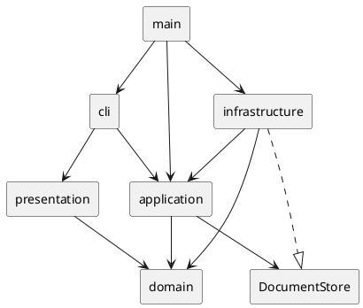
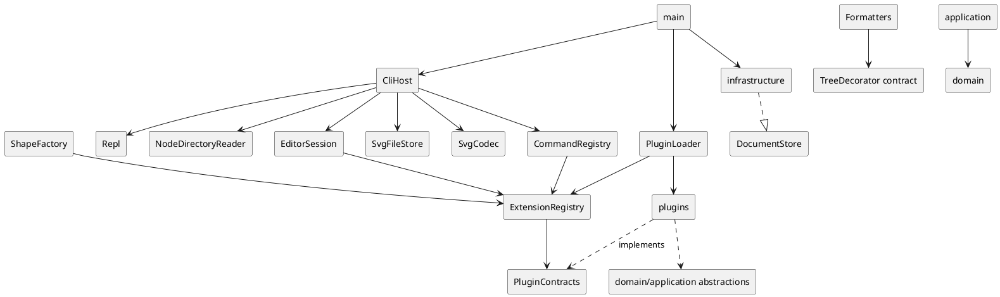
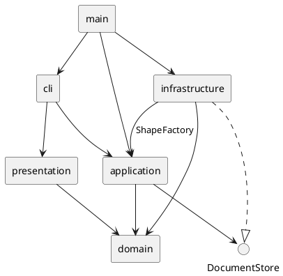

# SVG 编辑器 CLI 架构方案

本文以 Phase 2 当前实现为准；Phase 1 的原始设计记录保留在后文历史章节。使用方式见 [项目说明](../README.md)。

## Phase 2 当前架构

Phase 2 在 CLI 的应用侧加入四个插件扩展点，并新增独立的 VS Code 扩展。内核依赖扩展契约和注册表，不导入具体插件；插件由组合根装配，文件系统和 VS Code API 分别留在外层适配代码。

### 模块和依赖

```text
src/
  main.ts                              # 组合根：默认代码装配或 --config
  assembly/PluginLoader.ts             # 配置校验、ESM 加载和插件安装
  assembly/CliHost.ts                  # 装配应用会话、CLI 与基础设施适配器
  application/extensions/
    PluginContracts.ts                 # 四类扩展接口及插件清单
    ExtensionRegistry.ts                # 暂存注册、校验清单、原子提交
  application/DirectoryReader.ts        # dir 使用的目录访问端口
  infrastructure/NodeDirectoryReader.ts # Node 文件系统适配器
  plugins/
    shapes/BuiltinShapesPlugin.ts       # 六种内置图形
    stats/StatsPlugin.ts                # stats 命令
    dir/DirPlugin.ts                    # dir 命令
    box/BoxPlugin.ts                    # box、属性处理器和类型标签
    tree/ModifiedStarPlugin.ts          # dirty 状态标签
vscode-extension/src/
  extension.ts                          # 向 VS Code 注册 provider
  FileDecorationProvider.ts             # Explorer SVG 标记
  SvgOutlineProvider.ts                 # 原生大纲适配
  svgOutline.ts                         # XML 节点和源码范围
```

Phase 1 的主要依赖关系：



Phase 2 在应用内增加稳定扩展契约，并把动态模块发现留在装配边界：



`ExtensionRegistry.install()` 在私有暂存上下文运行插件的 `activate`，核对 `contributes` 与实际注册名集合，再检查跨插件重名；任一检查失败都丢弃这批暂存项，不影响已安装插件。代码装配调用 `PluginLoader.install(plugin, options)`，配置装配解析模块及 `package.json` 清单后也进入同一个 `install` 路径。配置数组顺序就是注册顺序，`enabled: false` 不导入模块，相对路径以配置文件为基准，包名按 CLI 的 ESM 运行环境解析。

### 扩展点清单

| 接口 | 职责与内核调用位置 | 实现 | 禁用时的行为 | 违反契约时 |
|---|---|---|---|---|
| `ShapeProvider` | 创建及读回/写出图形；`ShapeFactory.create/fromElement/toElement` | `BuiltinShapesPlugin`、`BoxPlugin` | 六种内置图形仍装配；未加载 box 时 `create box` 报未知类型，带标记的 `<g>` 按普通组读回 | 同名注册或清单不一致时拒绝插件；多个读写器命中时拒绝该操作 |
| `PluginCommand`（扩展点名为 `Command`） | 命令分发与 help；`CommandRegistry.execute/help` | `StatsPlugin`、`DirPlugin` | 未注册命令报 `unknown command`，内置命令不变 | 同名命令拒绝安装；参数错误由命令报告 usage |
| `TreeDecorator` | 为树行生成标签；`Formatters.tree` 调用 `prepare/decorate`，`EditorSession.markDecoratorsSaved` 更新保存基线 | `ModifiedStarPlugin`、`BoxPlugin` | 无插件时 Phase 1 树输出保持原样 | 重复名称拒绝安装；插件只可通过目标和文档接口观察状态 |
| `AttributeHandler` | 为特定图形定义 `set` 语义；`EditorSession.prepareAttributeChange` 配合 `SetAttributeCommand` | `BoxPlugin` 的 `box-attributes` | 无命中时回退图形原有属性白名单 | 多个处理器同时命中时在修改前拒绝；处理器异常触发变更撤销，历史不前移 |

注册表以扩展类别和名称为唯一键。激活失败、重复名或清单不匹配都输出对应 `error:` 并丢弃当前插件的暂存注册；配置中某个插件失败不会阻止后续条目加载。包缺失、无默认导出、导入/依赖求值失败也分别报告，不会终止 REPL。

### 插件命令与目录适配器

`PluginCommand` 提供 `name`、`usage`、`help` 和 `execute(args, context)`，因此命令名称和参数说明由插件拥有。`stats` 深度优先遍历画布节点，按类型首次出现顺序统计叶子；普通组和 box 只计容器。

`dir` 依赖应用端口 `DirectoryReader`（`currentPath`、`list()`），不依赖 Node API。组合根把 `NodeDirectoryReader` 注入 `CommandRegistry`，它在构造时固定 `process.cwd()`，使用 `readdirSync` 返回直接子项；插件命令负责按目录、文件和特殊项排序并格式化。该关系对应 Adapter：端口是应用所需能力，Node 类把操作系统目录转换成端口数据，命令只处理稳定的数据接口。符号链接及其他特殊项显示为 `[OTHER]`，不遍历目标；读取异常转换成稳定的 `error: cannot read directory: <path>` 消息。`dir` 不需要 SVG 文档，不会触碰编辑历史。

### 属性、box 与树标签决策

#### ADR-1：属性变更按一次命令准备和提交

`AttributeHandler.handles` 只负责无副作用的匹配，`prepare` 返回一个 `GeometryChange`。零个命中沿用图形白名单，一个命中由该处理器负责，多个命中明确拒绝，不依赖注册顺序。`SetAttributeCommand` 先准备变更，再调用一次 `apply`；失败时调用同一变更的 `undo`，命令总线只在成功后更新历史。box 的 `fill`、`label` 分别委派给内部矩形或文本图形，因此一次 `set` 仍是一个 undo/redo 单元。处理器若组合多个子图形变化，应先全部准备，再通过一个 `GeometryChange` 提交并整体撤销。

#### ADR-2：已安装 box 的无效结构拒绝读入

`box` 使用 `<g data-kind="box">`，子部件 ID 固定为 `<id>-rect` 和 `<id>-label`。加载 box 插件时，缺少或类型错误的必要部件会使整次读入失败，保留活动文档；重复 ID 仍按全局唯一性规则拒绝。未加载 box 插件时，未知 `data-kind` 不丢弃通用 `<g>` 的子节点，而降级为普通组。这样安装插件后可获得强领域不变量，卸载插件后仍能查看文件结构。

#### ADR-3：dirty 按内容相对保存点比较

`modified-star` 在成功 `init/read/save` 后记录画布和每个节点的本地状态。`tree` 查询时按后序遍历比较节点属性及有序子节点 ID/type；节点或后代变化会标记自身和祖先容器，撤销回保存点后标记消失。插入或删除会改变父节点的子节点签名；被移动节点本身内容未变时，由父容器和祖先体现结构变化。同一行标签按注册顺序拼接，默认装配顺序为 `modified-star` 后 `box-type-label`，所以 box 行显示 `* (box)`。每次查询只扫描树一次，不再为每个节点重复构造完整后代字符串。

#### ADR-4：配置清单从插件包元数据校验

配置加载器先按 ESM 条件解析模块并导入默认导出，再读取最近的插件 `package.json` 中 `contributes` 清单。包清单覆盖代码对象中的声明，避免只有源码自述；解析出的实际注册名必须与清单分类及集合完全相等。插件进入暂存区且校验通过后才发布注册。模块缺失、模块自身或依赖求值失败分开报错，避免把依赖异常误报为插件不存在。

### VS Code 扩展与 Phase 1 复用

`vscode-extension/src/extension.ts` 是扩展入口。VS Code 加载并调用 `activate(context)`；扩展把 `SvgFileDecorationProvider`、`DocumentSymbolProvider` 和文件创建/删除/重命名事件订阅加入 `context.subscriptions`，由 VS Code 在 Explorer 更新或 Outline 请求符号时调用。

文件标记不是经典 Decorator 模式：实现没有包装一个文件对象或调用原对象后叠加行为，而是注册 VS Code 定义的 provider，按 URI 返回额外 `FileDecoration` 元数据。它更接近平台扩展点；`shouldDecorateSvg` 是将 URI/文件类型规则适配为布尔策略的纯函数。大纲 provider 则把 `svgOutline.ts` 的解析结果转换成 VS Code `DocumentSymbol` 和 `Range`，属于清晰的 API 适配。

SVG 语法节点遍历和 `xmldom` 使用经验可复用；Phase 1 的 `SvgCodec` 不适合作为大纲解析器，因为它要求完整、受支持的 SVG 并映射为编辑领域树，而文本编辑时 XML 暂时不完整很常见，大纲还必须保留精确源码范围。扩展因此只复用 XML parser，不依赖 CLI 的 `Shape`/`SvgDocument`。文件标记只看文件 URI/类型，与 SVG 内容及 CLI 文档模型无关。

```sh
pnpm build:vscode
code --extensionDevelopmentPath=./vscode-extension .
```

仓库中的真实运行效果截图： [Explorer 文件标记](../docs/images/vscode-svg-badge.jpg)；[源码定位与嵌套大纲](../docs/images/vscode-svg-outline.jpg)。测试另覆盖无 ID 元素、文档编辑刷新和不完整 XML 返回空大纲。

### 验收与指标

插件注册/失败回滚、`dir` 测试替身与真实文件系统、box 结构和属性撤销、dirty 保存点、VS Code Outline 解析及配置 CLI 启动均有独立测试。端到端 CLI transcript 对照代码装配和配置装配，分别覆盖 Phase 1 基线、Phase 1 §6.1 的 box 版本 B、以及 `stats`/`dir`；每组使用相同的固定工作目录内容并逐字节比较输出。

源码文件职责、按内核/装配/插件拆分的行数，以及复杂度变化通过 `pnpm metrics` 从 `final` 和 `p2` Git 引用生成，结果写入 [`docs/metrics/phase2.md`](../docs/metrics/phase2.md)。指标定义和纳入范围由 [生成脚本](../scripts/phase2-metrics.mjs) 固定，VS Code 扩展和依赖/构建产物不计入 CLI 重构指标。

## Phase 1 历史设计

以下章节保留 Phase 1 的最终实现记录，用作重构前对照；其中“box 属于后续阶段”等陈述只描述 Phase 1 时间点，不代表当前实现。

### 架构方案

### 模块划分

项目采用 TypeScript + 面向对象，主要类各自一个文件，小型关联接口与所属模块放在一起。

```text
src/
  main.ts                         # 组合入口，注入文件适配器并启动 CLI
  cli/
    Repl.ts                       # 读行、提示符、错误输出、退出生命周期
    Tokenizer.ts                  # 空白、双引号、空参数、整行注释
    CommandRegistry.ts            # 命令名分派、参数语法、用例调用及反馈
  application/
    EditorSession.ts              # 当前文档、文件路径、编辑入口与历史配对
    CommandBus.ts                 # EditCommand、undo/redo 栈及 IO 锁
    ShapeFactory.ts               # 唯一图形类型分派点，CLI/导入共用构造规则
    DocumentStore.ts              # 文档存储端口及读入结果接口
    arguments.ts                  # CLI 与工厂共享的参数检查
    commands/
      CreateCommand.ts            # 创建及撤销
      DeleteCommand.ts            # 删除、恢复完整子树
      MoveCommand.ts              # 叶子或整组平移
      ScaleCommand.ts             # 叶子或整组缩放
      SetAttributeCommand.ts      # 白名单属性编辑
      GroupCommand.ts             # 收编现有节点，恢复所有原位置
      UngroupCommand.ts           # 解组，恢复组及继承样式
      AddToCommand.ts             # 迁移到指定组
      ReorderCommand.ts           # 同级置顶和置底
  domain/
    document/SvgDocument.ts        # 画布、viewBox、文档树、ID 与结构不变量
    shape/
      Shape.ts                    # Shape、ShapeAttributes、GeometryChange
      StyledShape.ts              # 公共 ID 校验、样式白名单及恢复辅助方法
      RectShape.ts                # 矩形
      CircleShape.ts              # 圆
      EllipseShape.ts             # 椭圆
      LineShape.ts                # 直线
      TextShape.ts                # 文本位置及内容
      GroupShape.ts               # 有序子节点、防环、递归准备变更
  infrastructure/
    SvgCodec.ts                   # XML 解析、序列化、命名空间、缺失 ID
    SvgFileStore.ts               # 真实文件读写及临时文件替换
  presentation/
    Formatters.ts                 # 只读生成 tree/show 文本
test/
  domain/                         # 几何不变量、原子性、文档结构
  application/                    # 命令、工厂、会话及混合历史
  cli/                            # 输入、分发、真实进程及实验会话
  infrastructure/                 # SVG 往返与真实文件错误场景
  presentation/                   # 树形展示、属性及只读行为
  architecture/                   # 模块依赖方向检查
examples/
  flowchart.txt                   # 可回放的流程图命令
  flowchart.svg                   # 编译后 CLI 生成的结果
```

`SvgDocument` 负责文档结构、唯一 ID 和画布信息，图形类维护各自私有几何状态。查找采用树遍历。`EditorSession` 把当前文档与对应 `CommandBus` 配对保存，外部调用具体用例。`ShapeFactory` 同时服务文本命令与 XML 导入。



### 设计模式的选择与落地

| 模式或设计手法 | 实现位置与作用 | 取舍 |
|---|---|---|
| Command（命令模式） | 九个编辑命令实现 `EditCommand`，`CommandBus` 管理执行、撤销和重做 | 查询和文件操作不包装成可撤销命令 |
| Composite（组合模式） | 六种图形实现 `Shape`，组持有同接口的子节点并递归准备移动、缩放 | 命令不按图形标签分支；组样式按 SVG 规则继承 |
| 简单工厂 / 注册表 | `ShapeFactory` 集中类型构造，`CommandRegistry` 集中命令分派 | 保留两个静态 Map；当前不称为完整插件系统 |
| Facade（外观模式） | `EditorSession` 隐藏文档选择、命令构造、历史和文件路径 | 通用执行方法私有，调用者使用明确的用例方法 |
| Adapter（适配器）及依赖倒置 | `DocumentStore` 定义应用需要的能力，`SvgFileStore` 对接文件系统，`SvgCodec` 对接 XML | Node 文件 API 和第三方库仅位于外层 |
| 局部恢复记录 | `GeometryChange` 保存变更前后值，`ShapeLocation` 保存原对象、父容器及下标 | 使用闭包和小接口，不增加独立 Memento 类层次或通用事务框架 |

`StyledShape` 共享所有图形实际需要的 ID、样式和恢复行为；各子类仍负责几何属性白名单、尺寸及坐标约束。基类不认识具体图形标签。命令名只在 `CommandRegistry`，图形类型名只在 `ShapeFactory`。序列化通过图形的类型、属性和子节点接口工作；展示对文本位置和端点属性做排版。

### 依赖方向规则

| 模块 | 允许依赖 | 原因 |
|---|---|---|
| domain | domain | 领域规则可独立于终端、存储、XML 库运行 |
| application | application、domain | 组织用例、历史及存储端口，不选择外部实现 |
| presentation | presentation、domain | 查询模型并生成展示文本 |
| cli | cli、application、presentation、Node 终端 API | 负责输入和反馈，不直接构造具体图形或读取文件 |
| infrastructure | infrastructure、application、domain、外部 IO/XML 库 | 实现应用端口，复用工厂和领域校验 |
| main | 所有需要装配的外层模块 | 唯一组合入口，显式注入真实文件适配器 |

`arguments.ts` 的自由函数仅校验输入个数和数字，不承载领域行为。`test/architecture/Dependencies.test.ts` 自动检查上述静态 import 规则。

### 编辑原子性与历史

`EditCommand` 只有 `execute(document)` 和 `undo(document)`。总线只在操作成功后移动历史记录。每次新编辑使用新命令实例，重做复用原命令。失败保留两个栈；成功新编辑清空 redo 栈。

图形通过 `prepareMove/prepareScale/prepareSet` 先计算并验证结果，再返回可提交的 `GeometryChange`。组先准备所有后代，任何后代溢出都不会造成部分提交。撤销写回保存的原值，因此能精确还原大数浮点运算前的值。

`set` 恢复单个属性的旧值或原先未设置的状态。这样解组时可以同时准备多个继承属性，提交时不会相互覆盖。几何尺寸要求正数，坐标要求有限数，`stroke-width` 允许零。

`group` 先验证所有目标、ID 和祖先关系，再按原文档深度优先顺序收编。在最近公共父容器中，放到第一个相关分支的位置；同父容器时对应第一个被选节点的位置。这补充了实验未规定的跨父容器插入规则。撤销按原顺序恢复所有父容器和下标，保留对象身份。

`ungroup` 拒绝顶层容器，将嵌套组的子节点提升到组原来的位置。组上未被子节点覆盖的显式样式会下放，避免外观变化；撤销会恢复原组及样式的显式/未设置状态。空组也可解散和恢复。

`init/read/save` 与带参数的 `canvas` 成功后清空并锁定历史，undo/redo 报 `undo not allowed after io command`。下一次成功编辑解锁。无参数 `canvas`、`tree/show/help` 不影响历史。

### 文件与会话生命周期

`DocumentStore` 使用同步接口。当前是单用户 CLI，已有 REPL 按行同步调用；同步文件操作能保持回放的严格顺序，避免保存未完成时执行下一条编辑。大型文件会阻塞终端，若未来加入服务器或 GUI，再将端口改成异步并加入顺序调度；当前没有后台任务或并发写入。

`read` 完成 XML 解析、ID 分配和整个领域树校验后，才替换当前文档、历史和默认路径。显式 ID 先全量预留，自动分配不会抢占文件后面已有的 ID。警告只在成功读入后输出。

`save` 先编码，写入目标同目录的唯一临时文件，关闭后 rename 替换目标。成功后才更新默认路径并锁定历史；失败尝试清理本次临时文件。保存到目录、缺失父目录或编码失败会保留原文件及会话状态。

XML 采用 [`@xmldom/xmldom`](https://github.com/xmldom/xmldom) 的 DOMParser/XMLSerializer。解析器报告的 warning/error 都视为失败，禁止 DTD、非 SVG 命名空间和不支持的元素/属性。输出对属性和文本正确转义，文本内容写入字符节点。`viewBox` 可与画布尺寸不同并保持往返；`canvas w h` 会将其重置为 `0 0 w h`。

支持范围为六种元素、公共样式、各类型几何属性和纯文本/CDATA。长度支持普通数字及 `px`，不支持百分比或其他单位；`transform`、CSS、`path`、`tspan`、外部资源和其他扩展属性明确报错，不静默丢弃。`box` 属于后续插件阶段，本阶段按未知类型拒绝。

### 变化点假设

1. **新增图形：** 增加封装几何规则的类并注册到工厂；命令继续调用 `Shape`。容器当前基于 `GroupShape`，未来第三方容器出现时再提取容器能力接口。
2. **新增命令或入口：** CLI 扩展注册表；其他入口复用会话用例。当前创建接口接收文本参数，GUI 出现后再提供类型化创建请求。
3. **更完整 SVG：** 主要扩展 codec 与模型的表达范围，特别是 transform、字体和 CSS；不能通过简单忽略属性声称支持。
4. **其他存储：** 实现 `DocumentStore` 并在 main 注入，不改变编辑命令。
5. **更大文档：** 当前树遍历与局部恢复记录足够；有性能证据后再增加索引、迭代遍历或历史容量限制。
6. **并发和异步：** 当前同步 CLI 无并发编辑；切换异步 IO 必须同步设计任务顺序和会话版本校验。

## 过程记录

早期草案曾将 XML 库节点暴露给领域工厂，并把所有属性放进公共字典。之后确定 XML 数据留在适配层，图形类封装几何字段和不变量。当前工厂放在应用层，导入器与 CLI 共享类型构造。

2026-10-21，删除、迁移、排序和创建接入命令总线。测试使用 ID 冲突、失效容器、缺失目标验证失败保持历史。排序恢复原下标，不能简单用相反的 front/back 撤销。CLI 进程测试曾发现退出后继续执行缓冲输入；关闭时解除 line 监听后修复。

2026-10-22，接口复查移除了 `move = prepareMove(...).apply()` 等重复入口，统一准备变更；同时补齐整组缩放原子性和数值溢出/下溢校验。Front/Back 合并为 `ReorderCommand`，会话通用执行方法改为私有。

2026-10-23，按以下完整能力分批实现并验证：

- 补齐 circle/ellipse/line/text、公共样式、scale/set 和撤销。发现文本内容可以恰好为 `in`，移除把所有末尾 `in` 都判为残缺子句的检查，交给具体创建语法校验。
- 实现跨容器分组与解组，固定顺序、最近公共父容器和恢复位置的语义。
- 解组复查发现：若多个属性变更都恢复整份样式快照，后应用的变更会覆盖前一个。改为单属性恢复，并补充同时继承 fill/stroke/stroke-width 的回归测试。
- 实现存储端口、SVG codec、真实文件适配器、read/save/help。外部 SVG 读入先验证整个新文档，保存采用临时文件替换。
- 真实 CLI 实验回放的测试在临时目录启动时无法按裸包名找到 tsx。测试启动器改为解析 loader 的绝对 URL，验证从任意工作目录启动程序的场景。
- 补齐文本与连线的树形展示、可回放示例、依赖方向测试和最终文档。

## 一致性自查

实际目录与本方案一致。相对早期方案，没有引入独立 ShapeService、History、通用 Result、Provider 插件层或每条查询一份命令类。真正出现 IO 需求后才加入 DocumentStore 和 infrastructure；新增共享样式需求后才引入 StyledShape。

依赖方向由自动测试检查，领域层不导入 Node、应用、终端或 XML 库。图形类型构造集中在工厂；命令分发集中在注册表；XML 和文件系统不进入领域层。

| 验收范围 | 实现与验证 |
|---|---|
| 六种图形 | 创建、几何校验、公共样式、各自属性白名单、文本内容 |
| 文档命令 | init/read/save/canvas、默认路径、成功锁历史、失败保留状态 |
| 编辑命令 | create/delete/move/scale/set/group/ungroup/addto/front/back |
| 查看与交互 | tree/show/help、引号、空参数、注释、错误前缀、EOF/exit/quit |
| 历史 | 每条编辑一个步骤、混合命令恢复、redo 分支、失败不消耗记录 |
| 文件格式 | 命名空间、缺失/重复 ID、实体转义、CDATA、viewBox、非法 XML 拒绝 |
| 示例 | 编译产物回放两节点流程图，生成 8 个元素的 SVG |

明确保留的边界：

- `requireDocument()` 返回原文档，`GroupShape.add/remove` 公开，类型系统未禁止绕过会话编辑或跨文档共享对象。
- 准备变更要求同步提交，历史按逆序撤销，不支持跨任意编辑延迟提交。
- 当前支持的是 SVG 子集，不是通用 SVG 文件的无损编辑器。

## 质量保证手段

| 命令 | 结果 |
|---|---|
| `pnpm.cmd typecheck` | 业务代码严格类型检查通过 |
| `pnpm.cmd typecheck:test` | 测试代码严格类型检查通过 |
| `pnpm.cmd test --test-reporter=dot` | 194 项通过，0 失败 |
| `pnpm.cmd build` | 编译通过，产物可独立执行 |
| `cmd /c "node dist/main.js < examples\flowchart.txt"` | 成功生成 `examples/flowchart.svg`，8 个元素 |
| `git diff --check` | 无空白错误 |

测试了后代数值失败时整组不提交、精确浮点恢复、跨父容器撤销保持对象与顺序、多属性继承不覆盖、失败不损伤 redo、ID 分配避开后续显式 ID、XML 注入内容保持为文本、文件保存失败保持原内容，以及 exit 后不再处理缓冲命令。
