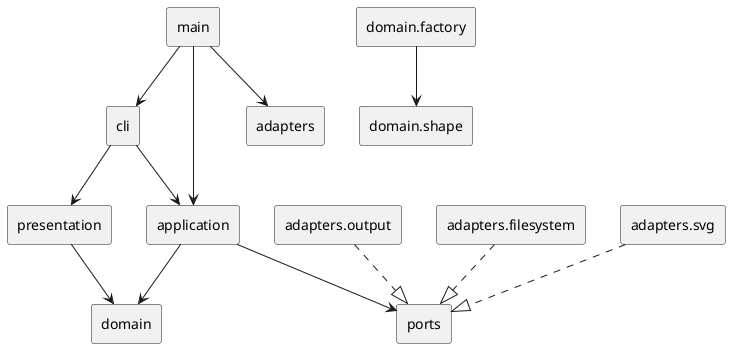

# SVG 编辑器 CLI 架构方案

本文是 `lab/phase_cli_1.md` 的项目结构、架构和实现约束。当前仓库处于设计阶段，文末的一致性自查会明确区分“已确认的方案”和“实现后才能确认的项目事实”。调研依据保存在 [`research-sources.md`](research-sources.md)，其中的来源链接指向 W3C、Node.js 和 TypeScript 官方资料。

## 架构方案

### 1. 模块划分

项目采用 TypeScript + 面向对象。每个主要类单独一个文件；模型对象封装自己的不变量和变换行为，CLI 不直接改模型字段。建议目录如下：

```text
src/
  main.ts                         # 组合根：创建适配器、应用服务并启动 CLI
  cli/
    Repl.ts                       # readline 循环、svg> 提示符、EOF 和注释行
    Tokenizer.ts                  # 双引号感知的参数分词
    CommandRegistry.ts            # 命令名到命令工厂的唯一分派点
    commands/                     # 一个 CLI 命令一个适配类
      InitCommand.ts
      ReadCommand.ts
      SaveCommand.ts
      CanvasCommand.ts
      CreateCommand.ts
      DeleteCommand.ts
      MoveCommand.ts
      ScaleCommand.ts
      SetCommand.ts
      GroupCommand.ts
      UngroupCommand.ts
      AddToCommand.ts
      FrontCommand.ts
      BackCommand.ts
      TreeCommand.ts
      ShowCommand.ts
      HelpCommand.ts
      UndoCommand.ts
      RedoCommand.ts
  application/
    EditorSession.ts               # 当前文档、文件路径、历史和 IO 状态
    CommandBus.ts                  # 执行、撤销、重做的用例入口
    History.ts                     # undo/redo 栈和 IO 锁定规则
    ShapeService.ts                # 创建、删除、分组、排序等用例编排
    Result.ts                      # 成功摘要、显示内容和错误结果
  domain/
    document/
      SvgDocument.ts               # 画布尺寸、顶层节点、唯一 ID 索引
      DocumentPath.ts              # 当前文件路径值对象
      DocumentSnapshot.ts          # 复杂命令的恢复快照
    shape/
      Shape.ts                     # 叶子与容器共享的 Composite 接口
      LeafShape.ts                 # 公共 ID、父引用和呈现属性
      GroupShape.ts                # g 容器、子节点顺序和递归变换
      RectShape.ts
      CircleShape.ts
      EllipseShape.ts
      LineShape.ts
      TextShape.ts
      ShapeId.ts                   # 非空、无空白、大小写敏感的 ID 值对象
      Geometry.ts                  # Point、Size 等值对象
      ShapeAttributes.ts           # 属性白名单和类型
    factory/
      ShapeFactory.ts              # 图形类型到构造器的唯一分派点
      ShapeProvider.ts             # 后续插件的注册接口
      BuiltinShapeProvider.ts      # rect/circle/ellipse/line/text/g
    errors/
      DomainError.ts               # 稳定错误码和参数
  ports/
    FileSystem.ts                  # 文本读写抽象
    SvgCodec.ts                    # SVG 解析/序列化抽象
    Output.ts                      # CLI 输出抽象
  adapters/
    filesystem/NodeFileSystem.ts   # node:fs/promises 适配器
    svg/XmlSvgCodec.ts             # XML parser/serializer 适配器
    output/ConsoleOutput.ts        # stdout/stderr 适配器
  presentation/
    Formatters.ts                  # tree/show/help 和命令摘要格式化
test/
  domain/
  application/
  cli/
  adapters/
```

模块职责：

- `domain` 是最内层。`SvgDocument` 保存画布和 ID 索引；`Shape` 层次保存 SVG 图形树。`RectShape` 等叶子类各自校验几何值，`GroupShape` 负责子节点顺序和递归操作。
- `domain/factory` 集中处理“类型名 -> 图形类”的构造。它是实验允许的第二处按名字分派点。`box` 在本阶段不注册，只保留 `ShapeProvider` 插槽供后续阶段使用。
- `application` 把用户意图编排成用例。`CommandBus` 是执行入口，`History` 只负责 undo/redo 状态，`EditorSession` 持有当前会话依赖但不承担 XML 或终端细节。
- `ports` 是应用需要的抽象接口；`adapters` 才能接触 Node 文件系统、XML 库和控制台。这样测试可以替换为内存文件系统、字符串 codec 和捕获输出。
- `cli` 只做文本解析、命令对象构造和结果转交；`presentation` 只读领域对象并生成 `tree`、`show` 等文本，不修改状态。
- `main.ts` 是组合根，负责依赖注入。除它之外不允许在业务类中偷偷创建 Node 适配器。

组件关系如下：



`domain` 的核心接口要小而深：

```ts
interface Shape {
  readonly id: ShapeId;
  readonly kind: string;
  readonly parent: GroupShape | null;
  move(dx: number, dy: number): void;
  scale(factor: number): void;
  setAttribute(name: AttributeName, value: AttributeValue): void;
  children(): readonly Shape[];
}

interface SvgDocument {
  readonly width: number;
  readonly height: number;
  resize(width: number, height: number): void;
  find(id: ShapeId): Shape | undefined;
  require(id: ShapeId): Shape;
  add(shape: Shape, parent?: GroupShape): void;
  remove(shape: Shape): DetachedSubtree;
  moveTo(shape: Shape, parent: GroupShape, index?: number): void;
}
```

这些接口隐藏父引用维护、ID 索引更新、子树递归和结构不变量；调用方不拿到可变数组，也不把属性当作公共数据袋。

### 2. 设计模式的选择与落地

#### Command（本阶段强制）

每条编辑命令封装一次完整用户意图：

```ts
interface Command {
  execute(session: EditorSession): CommandResult;
  undo(session: EditorSession): void;
  description(): string;
  kind(): 'edit' | 'document' | 'display';
}
```

`CreateCommand`、`MoveCommand`、`ScaleCommand`、`SetCommand`、`DeleteCommand`、`GroupCommand` 等保存参数以及 undo 所需的旧值或结构位置。`CommandBus` 执行成功的 `edit` 后压入 undo 栈并清空 redo 栈；失败时不改变文档和历史。`UndoCommand`、`RedoCommand` 由总线特殊转发，避免它们再次作为普通编辑命令入栈。

`DeleteCommand` 保存被摘下的子树、原父节点和索引；`GroupCommand` 保存各参与节点原父节点和相对顺序；`SetCommand` 和 `ScaleCommand` 对受影响子树保存快照。这样“一条 CLI 编辑命令 = 一个 undo 单元”，容器和插件复合图形也不会被拆成多个历史步骤。

`init`、`read`、`save` 和带参数的 `canvas` 是 `document` 命令。它们成功后清空 undo/redo 并标记 IO 锁；锁定期间 `undo`/`redo` 返回实验规定的错误。下一条成功编辑解除锁定。失败的文件读写不替换当前文档，也不清理历史。

#### Composite

`GroupShape` 和所有叶子都实现 `Shape`。命令只接受 `ShapeId`，不写“如果是 g 则……”的分支：

- 叶子在自身几何对象上实现 `move`/`scale`；
- `GroupShape` 对子孙递归调用同一接口，并保持子节点顺序；
- `delete` 通过 `SvgDocument.remove` 删除整棵子树；
- `group`、`addto`、`ungroup` 只操作树关系，不复制图形；
- `box` 后续由 `ShapeProvider` 创建为带 provider 标记的 `GroupShape`，因此现有命令无需增加 `box` 分支。

#### Factory / Provider

`ShapeFactory` 是实验允许的唯一图形类型分派点，集中注册六种内置类型。未来的 `BoxShapeProvider` 负责 `data-kind="box"`、子部件 ID 派生、`fill`/`label` 传播和读回还原。未知类型统一返回 `unknown shape type`，不会在领域类中散落 `switch(tag)`。

#### Adapter

`FileSystem`、`SvgCodec`、`Output` 是 seam 上的接口，Node/XML/控制台是 adapter。应用层通过构造函数注入它们，因而相同的命令可以在内存测试和真实 CLI 中运行。

XML codec 使用自己的中立元素数据（namespace URI、local name、属性、文本、子节点）调用 `ShapeFactory`，领域模型不导入 XML parser。导入完成后才替换 `EditorSession` 的当前文档；缺失 ID 由导入器按标签名和序号补齐，并将 warning 返回给 CLI。

### 3. 依赖方向规则

依赖箭头只能指向更稳定的内层接口：

| 模块 | 可以依赖 | 理由 |
|---|---|---|
| `domain` | `domain` 内部和值对象 | 领域规则不应被 Node、XML 或交互方式污染 |
| `ports` | `domain` 中必要的类型 | 端口描述文档和输出的抽象，不实现外部 IO |
| `application` | `domain`、`ports` | 编排用例，并通过端口注入外部能力 |
| `presentation` | `domain` 的只读展示能力 | 格式化 tree/show，不改变文档 |
| `cli` | `application`、`presentation` | 解析输入并调用总线 |
| `adapters` | `ports`、Node API、XML 第三方库 | 适配器是唯一接触外部实现的位置 |
| `main` | 组装所需的全部模块 | 组合根负责依赖注入 |

明确禁止：

- `domain` 导入 `cli`、`application`、`adapters`、`node:fs`、`readline` 或 XML 库；
- `application` 导入 `readline`、`console`、`node:fs` 或具体 XML parser；
- `cli` 直接访问 `SvgDocument` 的可变内部结构或自行操作历史栈；
- `presentation` 反向调用应用服务改变状态；
- 通过“万能 re-export”绕过层次规则或制造循环依赖。

实现后使用 `tsc --noEmit` 和依赖图检查抽样验证规则。发现违反时记为待处理项，而不是通过扩大接口掩盖依赖。

### 4. 变化点假设

1. **图形类型会增加。** 变化集中在 `ShapeProvider` 和 `ShapeFactory`；`box` 是下一阶段的第一个验证类型。Command 只依赖 `Shape`，无需为新类型逐条改命令。
2. **XML 库或运行环境会替换。** `SvgCodec` 隔离 parser 和 serializer；Node 文件读写通过 `FileSystem`，浏览器或内存测试可提供另一个 adapter。
3. **入口会从 REPL 扩展到脚本、GUI 或 HTTP。** 新入口只需构造同样的 Command 或调用 `CommandBus`，领域与应用层不随 UI 变化。
4. **undo 实现可能从快照改成事件日志。** 命令只依赖快照/恢复能力，本阶段使用内存栈，避免在需求尚未出现时引入持久化复杂度。
5. **tree/show 文本格式会调整。** 格式化集中在 `presentation/Formatters.ts`，不影响领域和命令。
6. **属性白名单会扩展。** 每个图形类声明自身几何属性和公共呈现属性；不建立全局动态属性袋。

有意不预留：任意 SVG 标签、CSS 样式表、动画、外部资源和 XPath 寻址。本阶段明确只支持 `svg`、`g`、`rect`、`circle`、`ellipse`、`line`、`text` 及实验要求的有限属性；过早通用化会削弱几何不变量和 Composite 语义。

## 过程记录

仓库初始只有实验说明、空的 `doc/README.md` 和基础元文件，没有既有代码结构可继承。因此先从命令表、错误语义、undo 粒度和 `box` 阶段边界提取架构约束，再查阅一手资料：W3C 资料确认 SVG 的 `id` 唯一性、命名空间、`g` 容器和文本子节点语义；Node.js 资料确认 `readline` 与 `node:fs/promises` 适合放入 CLI/IO adapter；TypeScript 资料确认现代 Node 项目使用模块和严格编译配置。

早期方案把 XML 节点类型直接暴露给领域工厂，后来改为 codec 内部的中立元素数据。这样领域层不需要知道 parser 的 DOM 类型，也不会因为更换 XML 库而修改图形模型。早期方案还把所有属性放进公共字典；对照实验中“禁止贫血模型”和 SVG 几何属性按元素区分的要求后，改为按图形类封装几何字段，并只让 `set` 经过每个类的白名单。

另一个确认点是 IO 原子性：`read` 解析失败时必须保留旧文档，`save` 只有写入成功才清理历史。复杂结构命令则先验证所有 ID、父子关系和索引，再一次性提交，避免错误输出之后留下部分修改。

## 一致性自查

当前提交是实现前的架构设计，尚不存在 `src/` 或 `test/`，所以不能声称实现目录已经与方案一致，也不能声称依赖规则已经通过代码抽样。实现完成后必须逐项补写结果：

1. **模块划分：** 对照 `src/`、`test/` 实际目录；新增、合并或移动的模块都写入本节修订记录。
2. **依赖方向：** 对 `src` 执行 TypeScript 编译和依赖图抽样，确认 `domain` 没有外层导入，adapter 只实现 ports，CLI 没有直接改模型或历史。

实现阶段若发现与本方案不一致，应在这里写“原方案、实际目录、原因、影响和修订日期”，不能静默改变文档。

## 质量保证手段

质量门槛按风险分层：

- **领域测试：** 覆盖六种内置图形的几何不变量、唯一 ID、父子关系、容器递归 `move`/`scale`、z-order 和非法环；验证 `delete`、`group`、`ungroup` 的错误不改变状态。
- **应用测试：** 用内存端口跑完整命令序列，验证每条编辑命令是一个 undo 单元、redo 在新编辑后清空、IO 命令锁定历史，以及失败命令不污染文档。
- **codec/adapter 测试：** 验证 SVG 命名空间、属性、文本转义、顺序、画布尺寸和缺失 ID warning；读写 round-trip 后再检查 `tree` 结果。
- **CLI 测试：** 验证引号文本、注释行、参数错误、统一 `error:` 前缀、`svg>` 提示符和典型 transcript。
- **静态检查：** `tsc --noEmit`、格式/ lint、`git diff --check`，并抽样检查依赖图；编译配置使用 `strict`，输出目录与源目录分离。
- **人工验收：** 保存的 SVG 用浏览器或 SVG Preview 打开；按实验中的两节点流程图、read 缺 ID、group/undo/redo 和 save/read 场景逐条回放。

实现顺序采用可运行的垂直切片：先完成模型和 `init/create/move/undo/redo`，再加入结构命令、SVG codec、REPL 展示，最后补齐错误场景和完整 transcript。每个切片单独提交，最终提交按实验要求打 `final` tag。
