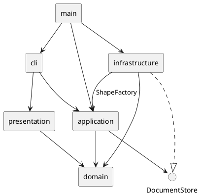

# SVG 编辑器 CLI 架构方案

本文记录 Phase 1 的最终实现，使用方式见 [项目说明](../README.md)。

## 架构方案

### 模块划分

项目采用 TypeScript + 面向对象，主要类各自一个文件，小型关联接口与所属模块放在一起。

```text
src/
  main.ts                         # 组合入口，注入文件适配器并启动 CLI
  cli/
    Repl.ts                       # 读行、提示符、错误输出、退出生命周期
    Tokenizer.ts                  # 空白、双引号、空参数、整行注释
    CommandRegistry.ts            # 命令名分派、参数语法、用例调用及反馈
  application/
    EditorSession.ts              # 当前文档、文件路径、编辑入口与历史配对
    CommandBus.ts                 # EditCommand、undo/redo 栈及 IO 锁
    ShapeFactory.ts               # 唯一图形类型分派点，CLI/导入共用构造规则
    DocumentStore.ts              # 文档存储端口及读入结果接口
    arguments.ts                  # CLI 与工厂共享的参数检查
    commands/
      CreateCommand.ts            # 创建及撤销
      DeleteCommand.ts            # 删除、恢复完整子树
      MoveCommand.ts              # 叶子或整组平移
      ScaleCommand.ts             # 叶子或整组缩放
      SetAttributeCommand.ts      # 白名单属性编辑
      GroupCommand.ts             # 收编现有节点，恢复所有原位置
      UngroupCommand.ts           # 解组，恢复组及继承样式
      AddToCommand.ts             # 迁移到指定组
      ReorderCommand.ts           # 同级置顶和置底
  domain/
    document/SvgDocument.ts        # 画布、viewBox、文档树、ID 与结构不变量
    shape/
      Shape.ts                    # Shape、ShapeAttributes、GeometryChange
      StyledShape.ts              # 公共 ID 校验、样式白名单及恢复辅助方法
      RectShape.ts                # 矩形
      CircleShape.ts              # 圆
      EllipseShape.ts             # 椭圆
      LineShape.ts                # 直线
      TextShape.ts                # 文本位置及内容
      GroupShape.ts               # 有序子节点、防环、递归准备变更
  infrastructure/
    SvgCodec.ts                   # XML 解析、序列化、命名空间、缺失 ID
    SvgFileStore.ts               # 真实文件读写及临时文件替换
  presentation/
    Formatters.ts                 # 只读生成 tree/show 文本
test/
  domain/                         # 几何不变量、原子性、文档结构
  application/                    # 命令、工厂、会话及混合历史
  cli/                            # 输入、分发、真实进程及实验会话
  infrastructure/                 # SVG 往返与真实文件错误场景
  presentation/                   # 树形展示、属性及只读行为
  architecture/                   # 模块依赖方向检查
examples/
  flowchart.txt                   # 可回放的流程图命令
  flowchart.svg                   # 编译后 CLI 生成的结果
```

`SvgDocument` 负责文档结构、唯一 ID 和画布信息，图形类维护各自私有几何状态。查找采用树遍历。`EditorSession` 把当前文档与对应 `CommandBus` 配对保存，外部调用具体用例。`ShapeFactory` 同时服务文本命令与 XML 导入。



### 设计模式的选择与落地

| 模式或设计手法 | 实现位置与作用 | 取舍 |
|---|---|---|
| Command（命令模式） | 九个编辑命令实现 `EditCommand`，`CommandBus` 管理执行、撤销和重做 | 查询和文件操作不包装成可撤销命令 |
| Composite（组合模式） | 六种图形实现 `Shape`，组持有同接口的子节点并递归准备移动、缩放 | 命令不按图形标签分支；组样式按 SVG 规则继承 |
| 简单工厂 / 注册表 | `ShapeFactory` 集中类型构造，`CommandRegistry` 集中命令分派 | 保留两个静态 Map；当前不称为完整插件系统 |
| Facade（外观模式） | `EditorSession` 隐藏文档选择、命令构造、历史和文件路径 | 通用执行方法私有，调用者使用明确的用例方法 |
| Adapter（适配器）及依赖倒置 | `DocumentStore` 定义应用需要的能力，`SvgFileStore` 对接文件系统，`SvgCodec` 对接 XML | Node 文件 API 和第三方库仅位于外层 |
| 局部恢复记录 | `GeometryChange` 保存变更前后值，`ShapeLocation` 保存原对象、父容器及下标 | 使用闭包和小接口，不增加独立 Memento 类层次或通用事务框架 |

`StyledShape` 共享所有图形实际需要的 ID、样式和恢复行为；各子类仍负责几何属性白名单、尺寸及坐标约束。基类不认识具体图形标签。命令名只在 `CommandRegistry`，图形类型名只在 `ShapeFactory`。序列化通过图形的类型、属性和子节点接口工作；展示对文本位置和端点属性做排版。

### 依赖方向规则

| 模块 | 允许依赖 | 原因 |
|---|---|---|
| domain | domain | 领域规则可独立于终端、存储、XML 库运行 |
| application | application、domain | 组织用例、历史及存储端口，不选择外部实现 |
| presentation | presentation、domain | 查询模型并生成展示文本 |
| cli | cli、application、presentation、Node 终端 API | 负责输入和反馈，不直接构造具体图形或读取文件 |
| infrastructure | infrastructure、application、domain、外部 IO/XML 库 | 实现应用端口，复用工厂和领域校验 |
| main | 所有需要装配的外层模块 | 唯一组合入口，显式注入真实文件适配器 |

`arguments.ts` 的自由函数仅校验输入个数和数字，不承载领域行为。`test/architecture/Dependencies.test.ts` 自动检查上述静态 import 规则。

### 编辑原子性与历史

`EditCommand` 只有 `execute(document)` 和 `undo(document)`。总线只在操作成功后移动历史记录。每次新编辑使用新命令实例，重做复用原命令。失败保留两个栈；成功新编辑清空 redo 栈。

图形通过 `prepareMove/prepareScale/prepareSet` 先计算并验证结果，再返回可提交的 `GeometryChange`。组先准备所有后代，任何后代溢出都不会造成部分提交。撤销写回保存的原值，因此能精确还原大数浮点运算前的值。

`set` 恢复单个属性的旧值或原先未设置的状态。这样解组时可以同时准备多个继承属性，提交时不会相互覆盖。几何尺寸要求正数，坐标要求有限数，`stroke-width` 允许零。

`group` 先验证所有目标、ID 和祖先关系，再按原文档深度优先顺序收编。在最近公共父容器中，放到第一个相关分支的位置；同父容器时对应第一个被选节点的位置。这补充了实验未规定的跨父容器插入规则。撤销按原顺序恢复所有父容器和下标，保留对象身份。

`ungroup` 拒绝顶层容器，将嵌套组的子节点提升到组原来的位置。组上未被子节点覆盖的显式样式会下放，避免外观变化；撤销会恢复原组及样式的显式/未设置状态。空组也可解散和恢复。

`init/read/save` 与带参数的 `canvas` 成功后清空并锁定历史，undo/redo 报 `undo not allowed after io command`。下一次成功编辑解锁。无参数 `canvas`、`tree/show/help` 不影响历史。

### 文件与会话生命周期

`DocumentStore` 使用同步接口。当前是单用户 CLI，已有 REPL 按行同步调用；同步文件操作能保持回放的严格顺序，避免保存未完成时执行下一条编辑。大型文件会阻塞终端，若未来加入服务器或 GUI，再将端口改成异步并加入顺序调度；当前没有后台任务或并发写入。

`read` 完成 XML 解析、ID 分配和整个领域树校验后，才替换当前文档、历史和默认路径。显式 ID 先全量预留，自动分配不会抢占文件后面已有的 ID。警告只在成功读入后输出。

`save` 先编码，写入目标同目录的唯一临时文件，关闭后 rename 替换目标。成功后才更新默认路径并锁定历史；失败尝试清理本次临时文件。保存到目录、缺失父目录或编码失败会保留原文件及会话状态。

XML 采用 [`@xmldom/xmldom`](https://github.com/xmldom/xmldom) 的 DOMParser/XMLSerializer。解析器报告的 warning/error 都视为失败，禁止 DTD、非 SVG 命名空间和不支持的元素/属性。输出对属性和文本正确转义，文本内容写入字符节点。`viewBox` 可与画布尺寸不同并保持往返；`canvas w h` 会将其重置为 `0 0 w h`。

支持范围为六种元素、公共样式、各类型几何属性和纯文本/CDATA。长度支持普通数字及 `px`，不支持百分比或其他单位；`transform`、CSS、`path`、`tspan`、外部资源和其他扩展属性明确报错，不静默丢弃。`box` 属于后续插件阶段，本阶段按未知类型拒绝。

### 变化点假设

1. **新增图形：** 增加封装几何规则的类并注册到工厂；命令继续调用 `Shape`。容器当前基于 `GroupShape`，未来第三方容器出现时再提取容器能力接口。
2. **新增命令或入口：** CLI 扩展注册表；其他入口复用会话用例。当前创建接口接收文本参数，GUI 出现后再提供类型化创建请求。
3. **更完整 SVG：** 主要扩展 codec 与模型的表达范围，特别是 transform、字体和 CSS；不能通过简单忽略属性声称支持。
4. **其他存储：** 实现 `DocumentStore` 并在 main 注入，不改变编辑命令。
5. **更大文档：** 当前树遍历与局部恢复记录足够；有性能证据后再增加索引、迭代遍历或历史容量限制。
6. **并发和异步：** 当前同步 CLI 无并发编辑；切换异步 IO 必须同步设计任务顺序和会话版本校验。

## 过程记录

早期草案曾将 XML 库节点暴露给领域工厂，并把所有属性放进公共字典。之后确定 XML 数据留在适配层，图形类封装几何字段和不变量。当前工厂放在应用层，导入器与 CLI 共享类型构造。

2026-10-21，删除、迁移、排序和创建接入命令总线。测试使用 ID 冲突、失效容器、缺失目标验证失败保持历史。排序恢复原下标，不能简单用相反的 front/back 撤销。CLI 进程测试曾发现退出后继续执行缓冲输入；关闭时解除 line 监听后修复。

2026-10-22，接口复查移除了 `move = prepareMove(...).apply()` 等重复入口，统一准备变更；同时补齐整组缩放原子性和数值溢出/下溢校验。Front/Back 合并为 `ReorderCommand`，会话通用执行方法改为私有。

2026-10-23，按以下完整能力分批实现并验证：

- 补齐 circle/ellipse/line/text、公共样式、scale/set 和撤销。发现文本内容可以恰好为 `in`，移除把所有末尾 `in` 都判为残缺子句的检查，交给具体创建语法校验。
- 实现跨容器分组与解组，固定顺序、最近公共父容器和恢复位置的语义。
- 解组复查发现：若多个属性变更都恢复整份样式快照，后应用的变更会覆盖前一个。改为单属性恢复，并补充同时继承 fill/stroke/stroke-width 的回归测试。
- 实现存储端口、SVG codec、真实文件适配器、read/save/help。外部 SVG 读入先验证整个新文档，保存采用临时文件替换。
- 真实 CLI 实验回放的测试在临时目录启动时无法按裸包名找到 tsx。测试启动器改为解析 loader 的绝对 URL，验证从任意工作目录启动程序的场景。
- 补齐文本与连线的树形展示、可回放示例、依赖方向测试和最终文档。

## 一致性自查

实际目录与本方案一致。相对早期方案，没有引入独立 ShapeService、History、通用 Result、Provider 插件层或每条查询一份命令类。真正出现 IO 需求后才加入 DocumentStore 和 infrastructure；新增共享样式需求后才引入 StyledShape。

依赖方向由自动测试检查，领域层不导入 Node、应用、终端或 XML 库。图形类型构造集中在工厂；命令分发集中在注册表；XML 和文件系统不进入领域层。

| 验收范围 | 实现与验证 |
|---|---|
| 六种图形 | 创建、几何校验、公共样式、各自属性白名单、文本内容 |
| 文档命令 | init/read/save/canvas、默认路径、成功锁历史、失败保留状态 |
| 编辑命令 | create/delete/move/scale/set/group/ungroup/addto/front/back |
| 查看与交互 | tree/show/help、引号、空参数、注释、错误前缀、EOF/exit/quit |
| 历史 | 每条编辑一个步骤、混合命令恢复、redo 分支、失败不消耗记录 |
| 文件格式 | 命名空间、缺失/重复 ID、实体转义、CDATA、viewBox、非法 XML 拒绝 |
| 示例 | 编译产物回放两节点流程图，生成 8 个元素的 SVG |

明确保留的边界：

- `requireDocument()` 返回原文档，`GroupShape.add/remove` 公开，类型系统未禁止绕过会话编辑或跨文档共享对象。
- 准备变更要求同步提交，历史按逆序撤销，不支持跨任意编辑延迟提交。
- 当前支持的是 SVG 子集，不是通用 SVG 文件的无损编辑器。

## 质量保证手段

| 命令 | 结果 |
|---|---|
| `pnpm.cmd typecheck` | 业务代码严格类型检查通过 |
| `pnpm.cmd typecheck:test` | 测试代码严格类型检查通过 |
| `pnpm.cmd test --test-reporter=dot` | 194 项通过，0 失败 |
| `pnpm.cmd build` | 编译通过，产物可独立执行 |
| `cmd /c "node dist/main.js < examples\flowchart.txt"` | 成功生成 `examples/flowchart.svg`，8 个元素 |
| `git diff --check` | 无空白错误 |

测试了后代数值失败时整组不提交、精确浮点恢复、跨父容器撤销保持对象与顺序、多属性继承不覆盖、失败不损伤 redo、ID 分配避开后续显式 ID、XML 注入内容保持为文本、文件保存失败保持原内容，以及 exit 后不再处理缓冲命令。