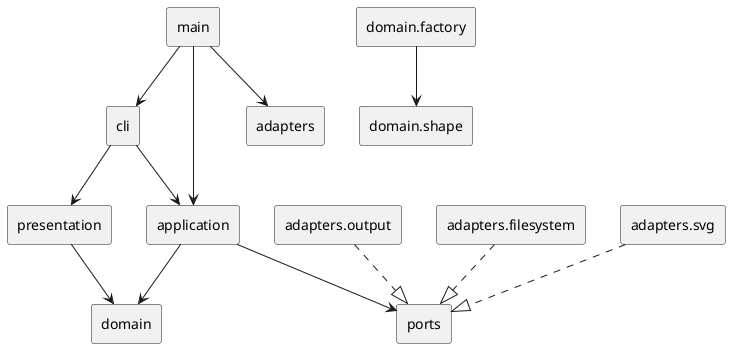

# SVG 编辑器 CLI 架构方案

本文记录 `lab/phase_cli_1.md` 的架构方案、实现进度和验证结果。截至 2026-10-21，项目已实现部分领域模型，以及内存中的删除、撤销和重做流程；CLI 尚未接入编辑命令。下文区分当前实现与后续设计目标，一致性自查记录具体差异。调研依据保存在 [`research-sources.md`](research-sources.md)；[`architecture-notes.md`](architecture-notes.md) 保留为实现前的历史草案，当前设计以本文为准。

## 架构方案

### 1. 模块划分

项目采用 TypeScript + 面向对象。每个主要类单独一个文件；模型对象封装自己的不变量和变换行为，CLI 不直接改模型字段。以下是更新后的目标目录，未标注“已实现”的模块仍属于规划；当前实现清单见一致性自查：

```text
src/
  main.ts                         # 已实现入口；目前仅创建并启动 Repl
  cli/
    Repl.ts                       # 已实现交互骨架，尚未接入应用命令
    Tokenizer.ts                  # 双引号感知的参数分词
    CommandRegistry.ts            # 命令名到命令工厂的唯一分派点
  application/
    EditorSession.ts               # 规划：当前文档、文件路径及对应总线
    CommandBus.ts                  # 已实现：EditCommand、执行、历史与 IO 锁
    ShapeService.ts                # 规划：必要的跨操作用例编排
    Result.ts                      # 规划：成功摘要、显示内容和错误结果
    commands/                     # 应用用例命令，不依赖终端或文本分词
      InitCommand.ts
      ReadCommand.ts
      SaveCommand.ts
      CanvasCommand.ts
      CreateCommand.ts
      DeleteCommand.ts            # 已实现：删除子树、撤销和重做
      MoveCommand.ts
      ScaleCommand.ts
      SetCommand.ts
      GroupCommand.ts
      UngroupCommand.ts
      AddToCommand.ts
      FrontCommand.ts
      BackCommand.ts
      TreeCommand.ts
      ShowCommand.ts
      HelpCommand.ts
  domain/
    document/
      SvgDocument.ts               # 已实现：尺寸、树遍历、ID 校验及结构操作
      DocumentPath.ts              # 当前文件路径值对象
      DocumentSnapshot.ts          # 复杂命令的恢复快照
    shape/
      Shape.ts                     # 已实现：ID、move/scale、children
      LeafShape.ts                 # 公共 ID、父引用和呈现属性
      GroupShape.ts                # 已实现：子节点顺序、防环和递归变换
      RectShape.ts                 # 已实现：矩形几何与平移、缩放
      CircleShape.ts
      EllipseShape.ts
      LineShape.ts
      TextShape.ts
      ShapeId.ts                   # 非空、无空白、大小写敏感的 ID 值对象
      Geometry.ts                  # Point、Size 等值对象
      ShapeAttributes.ts           # 属性白名单和类型
    factory/
      ShapeFactory.ts              # 图形类型到构造器的唯一分派点
      ShapeProvider.ts             # 后续插件的注册接口
      BuiltinShapeProvider.ts      # rect/circle/ellipse/line/text/g
    errors/
      DomainError.ts               # 稳定错误码和参数
  ports/
    FileSystem.ts                  # 文本读写抽象
    SvgCodec.ts                    # SVG 解析/序列化抽象
    Output.ts                      # CLI 输出抽象
  adapters/
    filesystem/NodeFileSystem.ts   # node:fs/promises 适配器
    svg/XmlSvgCodec.ts             # XML parser/serializer 适配器
    output/ConsoleOutput.ts        # stdout/stderr 适配器
  presentation/
    Formatters.ts                  # tree/show/help 和命令摘要格式化
test/
  domain/                          # 已实现：矩形、组和文档测试
  application/                     # 已实现：CommandBus 与 DeleteCommand 测试
  cli/
  adapters/
```

模块职责：

- `domain` 是最内层。`SvgDocument` 保存画布和根节点，通过树遍历查找 ID，并在加入、恢复时检查全局 ID 冲突；目前没有独立索引缓存或持久父引用。`Shape` 层次保存 SVG 图形树，`GroupShape` 负责直接子节点顺序和递归操作。
- `domain/factory` 集中处理“类型名 -> 图形类”的构造。它是实验允许的第二处按名字分派点。`box` 在本阶段不注册，只保留 `ShapeProvider` 插槽供后续阶段使用。
- `application` 把用户意图编排成用例。当前 `CommandBus` 绑定一个文档，集中持有 undo/redo 栈和 IO 锁；`EditCommand` 接口与总线定义在同一文件，不单独创建 `History.ts`。具体编辑命令放在 `application/commands`。后续 `EditorSession` 管理当前文档、对应总线和 IO 依赖。
- `ports` 是应用需要的抽象接口；`adapters` 才能接触 Node 文件系统、XML 库和控制台。这样测试可以替换为内存文件系统、字符串 codec 和捕获输出。
- `cli` 只做文本解析、命令对象构造和结果转交；`presentation` 只读领域对象并生成 `tree`、`show` 等文本，不修改状态。
- `main.ts` 是组合根，负责依赖注入。除它之外不允许在业务类中偷偷创建 Node 适配器。

组件关系如下：



当前 `domain` 的公开能力如下；属性更新、其他内置图形和值对象仍待实现：

```ts
interface Shape {
  readonly id: string;
  move(dx: number, dy: number): void;
  scale(factor: number): void;
  children(): readonly Shape[];
}

interface SvgDocument {
  readonly width: number;
  readonly height: number;
  resize(width: number, height: number): void;
  topLevel(): readonly Shape[];
  find(id: string): Shape | undefined;
  require(id: string): Shape;
  add(shape: Shape, index?: number): void;
  remove(shape: Shape): DetachedSubtree;
  restore(detached: DetachedSubtree): void;
  moveTo(shape: Shape, parent: GroupShape | null, index?: number): DetachedSubtree;
  bringToFront(shape: Shape): DetachedSubtree;
  sendToBack(shape: Shape): DetachedSubtree;
}
```

这些接口隐藏位置查找、子树遍历和结构校验。`topLevel()` 与 `children()` 返回数组副本，数组中仍引用原图形。`DetachedSubtree` 保存原对象、直接父容器和下标；删除时用于恢复，迁移和排序时表示操作前位置，返回它不意味着图形当前仍处于摘下状态。

`moveTo()` 的插入下标按摘下图形后的目标列表计算，省略时追加到末尾。置顶对应当前父容器的末尾，置底对应开头；排序和迁移均不改变几何值。

### 2. 设计模式的选择与落地

#### Command（本阶段强制）

当前每条可撤销的同步编辑实现以下接口，定义位于 `application/CommandBus.ts`：

```ts
interface EditCommand {
  execute(document: SvgDocument): void;
  undo(document: SvgDocument): void;
}
```

当前已实现 `DeleteCommand`：构造时保存目标 ID，执行成功后保存 `DetachedSubtree`，撤销成功后清除该记录。重复执行未撤销的实例、撤销未执行的实例均会被拒绝。失败的执行或恢复保留命令原状态，以便条件修正后重试。

`CommandBus.execute()` 在命令成功后压入 undo 栈、清空 redo 栈并解除 IO 锁。`undo()` 和 `redo()` 先读取栈顶，调用成功后再移动记录；失败时两个栈都不变。`redo()` 直接调用原命令的 `execute()`，以保留尚未重做的其余记录。撤销与重做通过总线方法调用，不作为新的编辑命令入栈。

命令契约要求 `execute()` 和 `undo()` 失败时文档及命令自身状态不变；总线负责历史的提交时机，不提供任意命令的自动回滚。应用编辑应统一经过总线，每次新编辑创建新的命令实例；重做复用原实例，同一实例不跨总线共享。

`lockAfterIO()` 已实现：清空两个栈并设置 IO 锁，锁定期间 undo/redo 都报告实验规定的 `undo not allowed after io command`；失败编辑不解锁，成功编辑解锁。它目前只管理内存状态。后续 `init/read/save` 和带参数的 `canvas` 成功后才调用该方法；新文档对应新的总线，失败的 IO 不替换文档或清理历史。`error:` 前缀由后续输出层添加。

后续结构命令保存原位置；`group` 的全部参与节点作为一个撤销单元，`set/scale` 的子树恢复需采用快照或等价的原子操作。这些命令、结果摘要及实际 IO 接线尚未实现。

#### Composite

当前 `GroupShape` 和 `RectShape` 都实现 `Shape`，通过统一接口遍历和变换。删除命令只保存字符串 ID，不区分叶子或组：

- 叶子在自身几何对象上实现 `move`/`scale`；
- `GroupShape` 对子孙递归调用同一接口，并保持子节点顺序；
- `delete` 通过 `SvgDocument.remove` 删除整棵子树；
- 文档级迁移和排序只操作树关系，不复制图形；应用层 `group/addto/ungroup/front/back` 命令待实现；
- `box` 后续计划由 `ShapeProvider` 创建为带 provider 标记的 `GroupShape`，复用容器操作。

#### Factory / Provider

此部分尚未实现。计划由 `ShapeFactory` 作为实验允许的唯一图形类型分派点，集中注册六种内置类型。未来的 `BoxShapeProvider` 负责 `data-kind="box"`、子部件 ID 派生、`fill`/`label` 传播和读回还原。未知类型统一返回 `unknown shape type`，避免在领域类中散落 `switch(tag)`。

#### Adapter

此部分尚未实现。计划以 `FileSystem`、`SvgCodec`、`Output` 作为外部依赖接口，Node/XML/控制台作为 adapter。应用层通过构造函数注入它们，支持内存测试和真实 CLI。

XML codec 使用自己的中立元素数据（namespace URI、local name、属性、文本、子节点）调用 `ShapeFactory`，领域模型不导入 XML parser。导入完成后才替换 `EditorSession` 的当前文档；缺失 ID 由导入器按标签名和序号补齐，并将 warning 返回给 CLI。

### 3. 依赖方向规则

依赖箭头只能指向更稳定的内层接口：

| 模块 | 可以依赖 | 理由 |
|---|---|---|
| `domain` | `domain` 内部和值对象 | 领域规则不应被 Node、XML 或交互方式污染 |
| `ports` | `domain` 中必要的类型 | 端口描述文档和输出的抽象，不实现外部 IO |
| `application` | `domain`、`ports` | 编排用例，并通过端口注入外部能力 |
| `presentation` | `domain` 的只读展示能力 | 格式化 tree/show，不改变文档 |
| `cli` | `application`、`presentation` | 解析输入并调用总线 |
| `adapters` | `ports`、Node API、XML 第三方库 | 适配器是唯一接触外部实现的位置 |
| `main` | 组装所需的全部模块 | 组合根负责依赖注入 |

明确禁止：

- `domain` 导入 `cli`、`application`、`adapters`、`node:fs`、`readline` 或 XML 库；
- `application` 导入 `readline`、`console`、`node:fs` 或具体 XML parser；
- `cli` 直接访问 `SvgDocument` 的可变内部结构或自行操作历史栈；
- `presentation` 反向调用应用服务改变状态；
- 通过“万能 re-export”绕过层次规则或制造循环依赖。

实现后使用 `tsc --noEmit` 和依赖图检查抽样验证规则。发现违反时记为待处理项，而不是通过扩大接口掩盖依赖。

### 4. 变化点假设

1. **图形类型会增加。** 变化集中在 `ShapeProvider` 和 `ShapeFactory`；`box` 是下一阶段的第一个验证类型。Command 只依赖 `Shape`，无需为新类型逐条改命令。
2. **XML 库或运行环境会替换。** `SvgCodec` 隔离 parser 和 serializer；Node 文件读写通过 `FileSystem`，浏览器或内存测试可提供另一个 adapter。
3. **入口会从 REPL 扩展到脚本、GUI 或 HTTP。** 新入口只需构造同样的 Command 或调用 `CommandBus`，领域与应用层不随 UI 变化。
4. **undo 实现可能从快照改成事件日志。** 命令只依赖快照/恢复能力，本阶段使用内存栈，避免在需求尚未出现时引入持久化复杂度。
5. **tree/show 文本格式会调整。** 格式化集中在 `presentation/Formatters.ts`，不影响领域和命令。
6. **属性白名单会扩展。** 每个图形类声明自身几何属性和公共呈现属性；不建立全局动态属性袋。

有意不预留：任意 SVG 标签、CSS 样式表、动画、外部资源和 XPath 寻址。本阶段明确只支持 `svg`、`g`、`rect`、`circle`、`ellipse`、`line`、`text` 及实验要求的有限属性；过早通用化会削弱几何不变量和 Composite 语义。

## 过程记录

仓库初始只有实验说明、空的 `doc/README.md` 和基础元文件，没有既有代码结构可继承。因此先从命令表、错误语义、undo 粒度和 `box` 阶段边界提取架构约束，再查阅一手资料：W3C 资料确认 SVG 的 `id` 唯一性、命名空间、`g` 容器和文本子节点语义；Node.js 资料确认 `readline` 与 `node:fs/promises` 适合放入 CLI/IO adapter；TypeScript 资料确认现代 Node 项目使用模块和严格编译配置。

早期方案把 XML 节点类型直接暴露给领域工厂，后来改为 codec 内部的中立元素数据。这样领域层不需要知道 parser 的 DOM 类型，也不会因为更换 XML 库而修改图形模型。早期方案还把所有属性放进公共字典；对照实验中“禁止贫血模型”和 SVG 几何属性按元素区分的要求后，改为按图形类封装几何字段，并只让 `set` 经过每个类的白名单。

另一个确认点是 IO 原子性：`read` 解析失败时必须保留旧文档，`save` 只有写入成功才清理历史。结构操作可先完成校验后提交，或在插入失败时恢复原位置；当前 `moveTo()` 使用后者。IO 接线和复杂结构命令仍需验证这些约定。

2026-10-21，将已有的文档删除与恢复接入 `EditCommand` 和 `CommandBus`。历史栈在命令调用成功后更新；测试通过实际 ID 冲突、失效父容器和缺失目标制造失败，确认撤销与重做记录可以保留并重试。IO 测试只覆盖锁定状态接口，不代表文件读写已经实现。

## 一致性自查

### 当前实现（2026-10-21）

| 范围 | 已实现与已验证 | 后续工作 |
|---|---|---|
| 领域层 | `Shape`、`RectShape`、`GroupShape`；文档尺寸、ID 查找与冲突检查、删除恢复、迁移排序 | 其他图形、属性、工厂、组合与解散、完整数值校验与变换失败回滚 |
| 应用层 | `CommandBus`、`DeleteCommand`；执行、undo/redo、失败保留历史、IO 锁定接口 | 其余命令、会话、结果输出及实际 IO 接线 |
| CLI | 启动、提示符、空行/注释及退出处理 | 分词、命令分发、编辑与显示命令接入；目前普通输入仍报告未实现 |
| 外部适配 | 尚未实现 | SVG codec、文件读写及输出端口 |
| 测试 | 60 项领域测试、14 项应用测试 | CLI、适配器及完整会话验证 |

### 设计修订记录（2026-10-21）

- **命令位置：** 原目录把具体命令列在 `cli/commands`；当前编辑命令位于 `application/commands`。执行和撤销属于应用用例，CLI 后续负责文本解析和构造命令；依赖方向保持为 CLI → application → domain。
- **历史模块：** 原方案单独设置 `History.ts`；当前 `CommandBus.ts` 同时定义小型 `EditCommand` 接口并管理两个栈及 IO 锁。命令调用与历史提交规则集中维护，当前没有独立的历史存储需求。
- **命令接口：** 原方案使用带会话、结果及类别的通用 `Command`；当前先实现同步 `EditCommand`，由总线传入固定文档。文件操作、显示、结果格式化仍为后续目标。
- **文档寻址：** 原方案预设 ID 索引和父引用；当前使用树遍历定位对象并返回位置记录，避免同时维护尚无必要的缓存。加入和恢复时检查全局 ID 唯一性，当前查找为线性遍历。

应用层及领域层的现有 import 已检查：领域层只依赖领域内部，应用层只依赖本层接口和领域类型；未发现 Node、CLI 或具体 IO 依赖进入这两层。当前 `main.ts` 仅启动 REPL，完整依赖组装和尚未实现模块的依赖检查仍待完成。

结构操作的当前约定是：组装子树后加入文档，后续应用编辑经由文档和命令总线。`GroupShape.add/remove` 仍公开，类型系统尚未禁止绕过这些入口；跨文档对象所有权也尚未封装。几何变换不能据现有结构测试宣称已满足全部失败原子性要求。

## 质量保证手段

以下为整个项目的质量目标，尚未实现的模块不计为已验证：

- **领域测试：** 覆盖六种内置图形的几何不变量、唯一 ID、父子关系、容器递归 `move`/`scale`、z-order 和非法环；验证 `delete`、`group`、`ungroup` 的错误不改变状态。
- **应用测试：** 用内存端口跑完整命令序列，验证每条编辑命令是一个 undo 单元、redo 在新编辑后清空、IO 命令锁定历史，以及失败命令不污染文档。
- **codec/adapter 测试：** 验证 SVG 命名空间、属性、文本转义、顺序、画布尺寸和缺失 ID warning；读写 round-trip 后再检查 `tree` 结果。
- **CLI 测试：** 验证引号文本、注释行、参数错误、统一 `error:` 前缀、`svg>` 提示符和典型 transcript。
- **静态检查：** `tsc --noEmit`、格式/ lint、`git diff --check`，并抽样检查依赖图；编译配置使用 `strict`，输出目录与源目录分离。
- **人工验收：** 保存的 SVG 用浏览器或 SVG Preview 打开；按实验中的两节点流程图、read 缺 ID、group/undo/redo 和 save/read 场景逐条回放。

实现顺序采用可运行的垂直切片：先完成模型和 `init/create/move/undo/redo`，再加入结构命令、SVG codec、REPL 展示，最后补齐错误场景和完整 transcript。每个切片单独提交，最终提交按实验要求打 `final` tag。

最近一次验证（2026-10-21）：

| 命令 | 实际结果 |
|---|---|
| `pnpm.cmd typecheck` | 通过，业务代码不输出编译文件 |
| `pnpm.cmd typecheck:test` | 通过，测试代码类型检查 |
| `pnpm.cmd test` | 74 项测试通过，0 失败 |

新增应用测试覆盖：整棵子树删除与恢复、命令生命周期、恢复失败后重试、多步历史顺序、新编辑清空 redo、执行/撤销/重做失败保留历史、IO 锁定仅由成功编辑解除，以及不同文档的总线隔离。当前结果验证内存中的领域和应用能力，不包含真实文件读写或 CLI 编辑会话。
