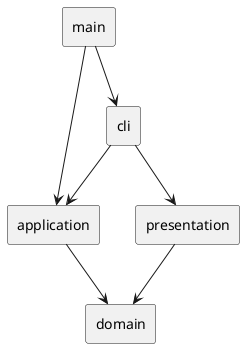

# SVG 编辑器 CLI 架构方案

本文记录 `lab/phase_cli_1.md` 的当前架构、修订理由与验证结果，更新于 2026-10-22。已实现矩形和组、文档树、部分编辑命令、撤销重做及 CLI 展示；完整实验尚未完成。调研依据见 [`research-sources.md`](research-sources.md)，[`architecture-notes.md`](architecture-notes.md) 保留实现前的历史草案，当前设计以本文为准。

## 架构方案

### 模块划分

项目采用 TypeScript + 面向对象。主要类各自一个文件；小型关联类型与使用它的模块放在一起。下面列出实际文件，不为尚未实现的功能预建类和目录。

```text
src/
  main.ts                         # 组装会话、分词器、注册表和 REPL
  cli/
    Repl.ts                       # 读行、提示符、输出、退出生命周期
    Tokenizer.ts                  # 空白、双引号、空参数、整行注释
    CommandRegistry.ts            # 唯一命令名分派点、用例调用及反馈
  application/
    EditorSession.ts              # 当前文档及其历史、具体编辑入口
    CommandBus.ts                 # EditCommand、undo/redo 栈、IO 锁
    ShapeFactory.ts               # 唯一图形类型分派点、创建参数解析
    arguments.ts                  # 工厂与 CLI 共用的文本参数检查
    commands/
      CreateCommand.ts            # 创建原对象、撤销、重做
      DeleteCommand.ts            # 删除和恢复整棵子树
      MoveCommand.ts              # 将叶子或整组平移纳入一个历史步骤
      AddToCommand.ts             # 迁移到指定组、恢复原位置
      ReorderCommand.ts           # 统一处理同级置顶和置底
  domain/
    document/
      SvgDocument.ts              # 画布、文档树、全局 ID、结构操作与位置记录
    shape/
      Shape.ts                    # Shape、ShapeAttributes、GeometryChange
      RectShape.ts                # 矩形不变量、可恢复的几何变更
      GroupShape.ts               # 子节点顺序、防环、递归准备几何变更
  presentation/
    Formatters.ts                 # 只读生成 tree/show 文本
test/
  application/                    # 工厂、会话、命令及历史测试
  domain/                         # 几何不变量、原子性及文档树测试
  cli/                            # 参数分发、分词、真实 CLI 进程测试
  presentation/                   # 展示格式及只读行为测试
```

`SvgDocument` 维护文档结构和全局 ID 唯一性；`Shape` 实现维护自己的几何规则。`GroupShape` 只管理直接子节点，并通过相同接口递归操作子树。查找采用树遍历，尚无必要维护第二套 ID 缓存或父指针。

`EditorSession` 将当前文档与对应 `CommandBus` 配对保存。CLI 调用具体用例，由会话创建编辑命令并提交历史。通用 `execute` 为会话私有实现，外部无需同时了解会话和命令组装。

`ShapeFactory` 接收图形类型及文本参数，负责将创建请求转换为领域对象，因此放在应用层。工厂和注册表共享 `arguments.ts` 的参数个数与有限数解析；正数、坐标溢出等领域约束仍由模型校验。这里的两个自由函数只处理输入，不代替领域对象的行为。

`Repl` 是当前终端 IO 边界，集中处理异常并只添加一次 `error:` 前缀。`Formatters` 查询领域对象并返回字符串，不编辑文档、不操作历史。



### 设计模式的选择与落地

| 模式或设计手法 | 当前用途 | 取舍 |
|---|---|---|
| Command（命令模式，实验要求） | 编辑对象保存执行参数和恢复记录；总线管理历史 | 保留；只有可撤销编辑实现 `EditCommand`，不把查询、退出和初始化也包装成命令类 |
| Composite（组合模式） | 矩形与组实现 `Shape`；组递归准备后代变更 | 保留；应用命令无需区分叶子和组，不在命令中按图形类型分支 |
| 简单工厂 / 注册表 | `ShapeFactory` 的 Map 集中构造图形；`CommandRegistry` 的 Map 集中分发命令 | 保留；当前不是 Abstract Factory 或完整插件系统，不增加无实际调用者的 Provider 层 |
| Facade（外观模式） | `EditorSession` 隐藏当前文档选择、命令创建与历史配对 | 保留；这是实际用例边界，通用执行细节保持私有 |
| 局部恢复记录 | `GeometryChange` 捕获几何原值，`ShapeLocation` 保存原对象和位置 | 直接使用闭包与小型接口；无需增加独立的 Memento 类层次或通用事务框架 |

#### 编辑历史

`EditCommand` 与总线定义在同一文件，只有两个操作：`execute(document)` 和 `undo(document)`。执行、撤销或重做失败时，文档及命令自身状态应保持不变。总线在命令成功后才移动历史记录，不为任意命令自动回滚。

新编辑成功后进入 undo 栈、清空 redo 栈并解除 IO 锁。重做调用原命令的 `execute()`，保留其他尚未重做的记录。命令实例只属于一个总线；普通编辑创建新实例，重做复用原实例。重复执行未撤销的命令、撤销未执行的命令会被拒绝。

`init` 在新文档建立成功后整体替换文档与历史；`canvas` 修改成功后保留文档对象、清理并锁定历史。失败保持旧状态；查询不影响历史。`read/save` 尚未实现，不能由内存 IO 锁测试推断文件操作已正确。

`ReorderCommand(id, "front" | "back")` 合并原有两个几乎相同的命令类。CLI 仍提供 `front` 和 `back` 两条指令；领域层保留 `bringToFront/sendToBack`，它们封装当前父容器及对应绘制顺序。已经位于边界的成功排序仍占一个历史步骤。

创建、删除、迁移和几何编辑保存的输入及恢复状态不同。各自少量生命周期检查暂时保留；仅为消除几行重复而建立通用命令基类，会让状态类型、钩子方法和失败时机更难追踪。

#### 几何原子性与撤销

`Shape` 仅提供 `prepareMove` 和 `prepareScale`，没有另一套直接修改的 `move/scale`。准备方法计算并校验结果，返回 `GeometryChange { apply, undo }`；准备过程不修改图形。组先准备所有后代，全部成功后调用者才能提交，因此后面的子图形失败不会留下前面已修改的状态。

保留准备阶段有实际原因：整组变更需要原子性，撤销需要恢复原始数值。`undo` 写回保存的值，不通过反向平移或除以缩放因子恢复，避免浮点舍入让原值丢失。矩形的平移和缩放共用私有恢复逻辑，同时检查坐标、尺寸溢出以及尺寸下溢到零。

`MoveCommand` 完成目标查找、同步准备和提交，并保存原对象及变更。撤销先确认目标仍是原对象，再恢复几何。缩放的领域能力已经统一，但 `ScaleCommand` 和 CLI `scale` 尚未接入。

这些几何变更是同步使用的：准备与提交之间不能插入其他编辑，多步变更按执行的逆序撤销。当前没有异步编辑或并发调度。将来增加异步输入时，应由应用层串行执行编辑；当前记录不具备版本冲突检测能力。

#### 文档结构与恢复

`ShapeLocation` 在 `SvgDocument.ts` 内定义，包含 `shape`、`parent` 和 `index`，描述记录时的位置，不表示图形当前是否已摘下。删除用 `restore()` 重新插入子树；迁移和排序用 `moveTo()` 将仍在文档内的原对象移回原位置。

`add()` 统一顶层和组内插入、父容器身份与全局 ID 检查；`restore()` 复用它。`moveTo()` 的下标按摘下节点后的目标列表计算；插入失败时恢复原位置，再抛出错误。`topLevel()`、`children()` 和 `attributes()` 返回独立副本，其中节点数组仍引用原对象。

### 依赖方向规则

| 模块 | 允许依赖 | 原因 |
|---|---|---|
| `domain` | 领域内部 | 图形与文档规则不依赖文本命令、终端或 XML 库 |
| `application` | 本层与 `domain` | 解析应用请求、编排领域行为并管理历史 |
| `presentation` | `domain` 的查询能力 | 展示不修改状态、不调用应用编辑 |
| `cli` | `application`、`presentation`；REPL 使用 Node 读行 | 文本交互留在外层 |
| `main` | 组装所需模块 | 组合根创建依赖 |

领域层禁止导入应用层、CLI、Node IO 或 XML 库；应用层禁止导入 CLI、`readline` 或具体 XML parser。CLI 编辑须调用会话用例，不能直接调用图形或文档的修改方法。实际 import 已按这些方向检查。

`CommandRegistry` 和 `ShapeFactory` 是实验允许的两处按名字分派点，标记为**插件扩展时待重构**。当前集中注册足以支持已有功能；增加第三处类型或命令名分派前，应先调整这两个入口。

### 变化点假设

1. **新增图形：** 新类实现 `Shape` 并加入工厂；编辑和展示使用统一接口。当前未引入只有 ID 公共字段的 `LeafShape` 基类。
2. **SVG 文件读写：** 实现时隔离 XML 和文件系统，成功后再替换文档或清理历史；当前不预建空的 `ports/adapters/DocumentPath/DocumentSnapshot`。
3. **插件注册：** 出现第一种外部图形时再确定注册与读写协议，不凭尚未实现的 `box` 提前规定 Provider 层次。
4. **其他入口：** 复用 `EditorSession` 的具体用例。创建当前接收文本参数；若 GUI 或导入器需要类型化请求，再结合真实调用者调整，不声称现有创建接口完全与输入形式无关。
5. **展示格式：** 集中修改 `Formatters`；不为唯一终端实现增加无调用需求的 `Output` 接口。
6. **规模与并发：** 当前树遍历和同步内存历史足够；只有性能证据或异步需求出现后再引入索引、版本号或调度机制。

## 过程记录

仓库起初只有实验说明和基础元文件。早期讨论从命令表、错误语义、撤销粒度和后续 `box` 阶段边界提取约束；调研记录保留 SVG 的 ID、容器、文本、命名空间以及 Node/TypeScript 的相关依据。

早期草案曾将 XML 库节点类型暴露给领域工厂，并把所有属性放进公共字典。讨论后决定：未来 codec 隔离 XML 数据类型，图形类封装自己的几何字段及不变量。文件读写的实现仍未完成，这些属于约束而非已交付能力。

2026-10-21，删除与恢复接入命令总线，随后加入迁移、排序、创建及会话。测试通过真实 ID 冲突、失效父容器、缺失目标验证失败保留历史；混合历史确认排序必须恢复原下标，不能简单执行相反的置顶或置底。

文档 CLI 接线时，真实进程测试发现退出后仍处理缓冲输入：`close()` 不保证当前批次停止触发 `line`。修复在关闭时解除 REPL 的监听，相关回归测试现已通过。之后接入创建、删除、结构编辑及 `tree/show`，原文档未同步这些进度，本次已纠正。

2026-10-22，用户指出新加入 `prepareMove` 后仍保留 `move = prepareMove(...).apply()` 没有实际必要，并要求删除冗余、检查设计。复查确认：先前教学分步演进后未及时收束接口，又用不存在的兼容需求解释重复入口，这个理由不成立。后续按完整业务单元完成接口替换和调用迁移。

本次直接清理了以下问题：

- 删除直接变换入口，调用方统一使用准备变更；同时修复原缩放路径缺少整组原子性、坐标溢出和尺寸下溢校验的问题。
- 合并 `FrontCommand/BackCommand` 为 `ReorderCommand`，会话对应只保留一个排序用例；删除旧类，不保留别名。
- 会话通用执行方法改为私有，测试改用公开用例或直接测试命令总线，避免为测试保留额外生产接口。
- 工厂移入应用层，共享参数解析，领域层不再包含创建命令的文本语法；CLI 单 ID 参数校验也集中处理。
- `DetachedSubtree` 改名 `ShapeLocation`，统一删除、迁移和排序所使用的位置语义。
- 移除当前架构中的预设空模块，更新过时的命令、工厂、展示和测试状态；历史草案仍可查阅。

## 一致性自查

实际目录与上面的当前架构一致。相对早期方案，未建设 `ShapeService`、独立 `History`、通用 `Result`、每条 CLI 对应的命令类、Provider 层或 IO 空接口；这些不是漏建文件，而是缺少当前职责和调用需求。文件读写等实验功能依然需要后续实现。

| 范围 | 已实现并验证 | 尚未实现或限制 |
|---|---|---|
| 图形与文档 | 矩形、组、查找与唯一性、删除恢复、迁移排序、准备平移和缩放 | circle/ellipse/line/text、完整属性、group/ungroup |
| 应用与 CLI | init/canvas/create/delete/move/addto/front/back/tree/show/undo/redo/exit/quit | scale/set/group/ungroup/read/save/help 等剩余命令 |
| 历史 | 同步编辑成功提交、失败保持历史、精确恢复几何、文档切换隔离 | 实际 IO 的成功/失败历史语义尚待接线验证 |
| 领域封装 | 几何字段私有；返回独立数组及属性快照 | 返回的领域对象仍可被直接修改，尚无所有权封装 |

仍需明确的边界：

- `requireDocument()` 返回原文档，`GroupShape.add/remove` 仍公开，类型系统未禁止绕过会话编辑、跨文档共享同一对象。当前 CLI 遵守统一入口；不能声称已实现完整的只读视图或所有权隔离。
- ID 的非空、无空白检查在创建工厂，文档检查全局唯一性。直接调用图形构造器不经过工厂时，不具有同等输入校验；未来导入路径必须补齐这一边界。
- `GeometryChange` 的有效期依赖同步提交与逆序撤销约定，不支持任意延迟提交，也不保证处理绕过历史后任意修改子树的情况。
- 图形类型分派仅在工厂，容器身份检查采用 `instanceof GroupShape`。若未来容器不再基于该类，应结合实际插件需求调整容器接口。

这些限制已记录，没有为消除尚未出现的调用场景而引入另一套框架。现有内存 CLI 通路的失败原子性和历史行为有测试支持，不能将它扩大为整个实验已经完成。

## 质量保证手段

截至 2026-10-22 的实际验证：

| 命令 | 结果 |
|---|---|
| `pnpm.cmd typecheck` | 通过，业务代码无输出类型检查 |
| `pnpm.cmd typecheck:test` | 通过，测试代码类型检查 |
| `pnpm.cmd test --test-reporter=tap` | 171 项通过，0 失败，0 跳过 |

本次保留并迁移原有 159 项测试，补充 12 项回归测试，覆盖：准备阶段不修改状态；后代溢出时整组不提交；缩放尺寸下溢；大数浮点情况下精确恢复；MoveCommand 生命周期与失败后重试；撤销、重做失败保留记录；几何与结构命令混合历史；参数分发及真实 CLI 会话。测试替身也同步新接口，修复此前运行测试通过但测试类型检查失败的问题。

现有测试还覆盖树结构、ID 冲突、原对象身份、历史锁、初始化隔离、分词、错误输出、展示和退出生命周期。静态检查使用严格 TypeScript 配置，配合 `git diff --check` 和 import 审查。当前没有配置 lint 脚本，不将其列为已通过检查。

后续验收仍需覆盖剩余图形与命令、SVG 文件往返读写、缺失 ID 警告、浏览器预览，以及实验规定的完整脚本。每轮以一个完整且可验证的能力或重构为边界推进，正常教学轮次仍由用户输入业务代码、Agent 维护测试；本轮直接修改来自用户明确授权。
